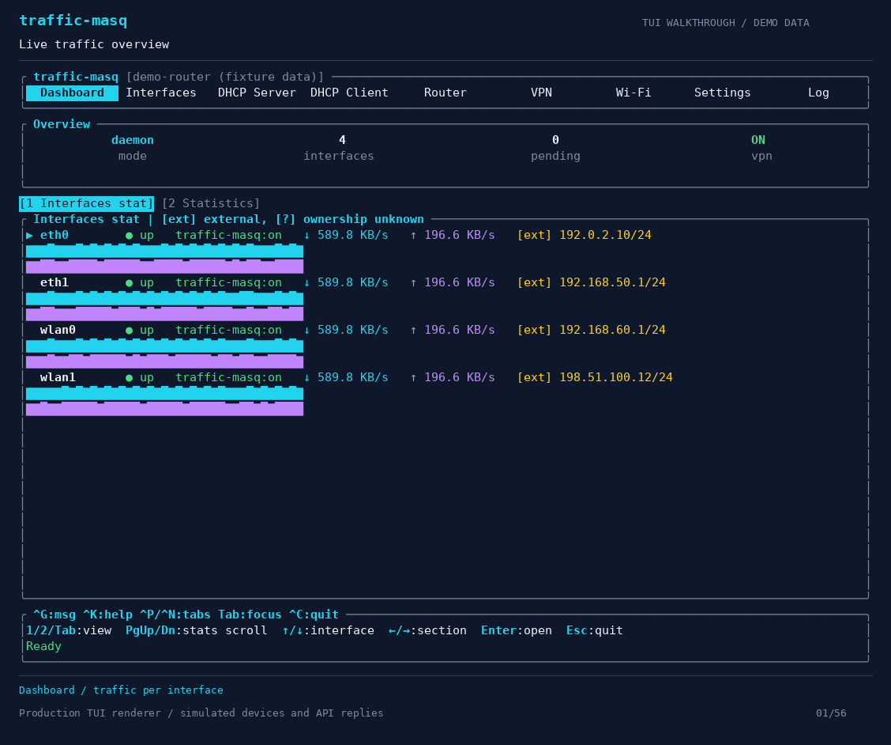

# traffic-masq — Linux router, Wi-Fi access point and WireGuard gateway

traffic-masq turns a Linux PC or mini PC into an IPv4 router, Wi-Fi access point
or WireGuard VPN gateway, managed through a terminal user interface (TUI).

Share an Internet connection with local devices using NAT and built-in DHCP,
configure a Wi-Fi hotspot with a compatible adapter, or route LAN traffic
through WireGuard tunnels. Manage the daemon locally or connect a remote
terminal client over HTTPS.



A continuous recording of keyboard-only interaction with the TUI, using demonstration data. See the
[chapter index](docs/media/tui-demo.chapters.txt).

```text
Internet ── WAN interface ── Linux machine ── LAN interface ── Local devices
                            traffic-masq       or Wi-Fi AP
```

The project has two programs:

- **`traffic-masqd`** is the daemon. It runs as root and configures networking.
- **`traffic-masq`** is the terminal client. It connects to the daemon to show
  network state and edit settings.

The project is under development. Use a spare machine for testing. Networking
is IPv4-only, apart from addresses inside WireGuard profiles.

## What can I use traffic-masq for?

- **Turn a Linux PC into a router:** connect WAN and LAN interfaces, assign
  client addresses with DHCP, and share Internet access through NAT. See
  [wired Internet sharing](#first-setup-share-a-wired-internet-connection).
- **Share Ethernet Internet over Wi-Fi:** configure a compatible wireless
  adapter as an access point with hostapd, then configure DHCP and Internet
  sharing for wireless clients. See [first setup](#first-setup-share-a-wired-internet-connection).
- **Share a Wi-Fi uplink through a separate access point:** use two radios
  and the [Wi-Fi router setup wizard](#wi-fi-router-setup-wizard) to configure
  the upstream connection, local AP and LAN settings together.
- **Set up a WireGuard gateway for LAN devices:** import WireGuard profiles
  and configure VPN policy routing or an ordered VPN chain. See
  [uplink and VPN chains](#uplink-and-vpn-chains).
- **Manage a Linux router from the terminal:** inspect interfaces, configure
  routes and DHCP, manage Wi-Fi, and view recent daemon logs. Use the
  [remote terminal client](#remote-terminal-client) to manage another machine.

## Confirm network changes before keeping them

Interface, router and Wi-Fi connection changes use an **Apply → Commit**
workflow. Apply changes the running network and starts a confirmation timer,
normally 60 seconds. If you lose access and cannot confirm in time, the daemon
schedules rollback. This requires a running daemon; restoration can take longer
while operations finish or recovery retries run.

See [applying and confirming changes](#applying-and-confirming-changes) for
coverage, immediate operations and crash-recovery behavior.

## Quick start

### 1. Build

From the repository root:

```sh
cargo build --release --locked
```

You need Linux, Rust 1.95.0 and a C compiler. The toolchain is pinned in
`rust-toolchain.toml`. Some build targets also need CMake.

The daemon needs `nft` with JSON support and kernel support for the features you
use. For Wi-Fi, install `hostapd` for AP mode or `wpa_supplicant` for client mode.
DHCP server and client are built in. WireGuard uses the kernel's netlink API;
`wireguard-tools` is not needed to run the application.

### 2. Install and start the daemon

```sh
sudo ./target/release/traffic-masqd install
```

The installer first shows network-manager and socket conflicts with manual
resolution advice, and rechecks after installing dependencies. The wizard accepts
dependency presets as one comma-separated list and shows a plan before making
changes. Its defaults
install into `/usr/local`, start the daemon and enable boot autostart when the
init system is recognized. Service integration supports systemd, OpenRC, runit
and SysVinit.

If you skipped startup, start it manually:

```sh
sudo /usr/local/sbin/traffic-masqd start
```

Check that it is running:

```sh
sudo /usr/local/sbin/traffic-masqd status
```

### 3. Open the terminal client

```sh
sudo /usr/local/bin/traffic-masq
```

Set the device password on this first launch. Initial password setup requires
a local root client; there is no default password.

If the installer granted your user socket access, sign out and back in before
running `traffic-masq` without sudo. The client will still ask for the device
password.

**A fresh installation manages no interfaces and does not share Internet access
yet.** Choose which interfaces to configure in the TUI.

To inspect interfaces before installing anything, use the read-only mode:

```sh
./target/release/traffic-masq --direct
```

## Updating an existing installation

To update an existing installation after building new release binaries:

```sh
sudo ./packaging/update.sh --dry-run
sudo ./packaging/update.sh
# Or use binaries downloaded by gitcompile.sh:
sudo ./packaging/update.sh --binary-dir ./binaries
```

The script validates the new binaries and existing configuration, stops the
daemon, updates through its native installer and starts it again. Configuration,
saved network settings, credentials and user access are retained. Stopping may
interrupt connectivity according to the configured shutdown policy. See
[service integration](packaging/INIT.md#ownership-updates-and-removal) for custom
paths, updating from release archives and leaving the daemon stopped.

## First setup: share a wired Internet connection

This example uses `wan0` for an interface that already has working Internet
access, and `lan0` for the local network. Substitute your actual interface names.
Both links must be up when you apply a sharing connection.

Before configuring `lan0`, release it from the distribution's network manager.
Competing NetworkManager, networkd or DHCP/Wi-Fi services can reclaim interfaces
and interfere with traffic-masq. See
[network manager conflicts and interface handover](docs/resource-conflicts.md#avoiding-conflicts-with-distribution-network-managers)
for persistent exclusions and checks. The existing externally managed `wan0`
can remain with its current manager in this example.

1. In **Interfaces**, select `lan0`, enable **Configure with traffic-masq**,
   choose role `output` and set an address such as `192.168.50.1/24`. Choose a
   subnet that does not overlap your upstream network. Review, apply and
   confirm the change.
2. In **DHCP Server**, configure a pool on `lan0`, for example
   `192.168.50.100`–`192.168.50.200`, with router `192.168.50.1` and DNS servers
   appropriate for your network. Keep static device addresses outside the pool.
3. In **Router → Internet sharing**, add a connection with **Traffic from** set
   to `lan0`, **Internet through** set to `wan0`, and **Masquerade** enabled.
   Save the connection, then review and apply the draft. Routing activates
   automatically when a sharing rule is configured.
4. Check that a device on `lan0` receives an address and can reach the Internet,
   then choose **Commit** before the confirmation timer expires.

The existing route through `wan0` supplies the upstream gateway. A sharing rule
allows forwarding and NAT; it does not obtain an upstream address or create a
route. Configure those separately if the Linux machine cannot reach the
Internet yet.

For a Wi-Fi LAN, configure an access point in **Wi-Fi** as well. Assigning an
address and a DHCP pool to a wireless interface alone does not create an AP.

## Wi-Fi router setup wizard

In **Router**, choose **Wi-Fi setup** or press **w** to configure a Wi-Fi uplink
and a local access point on two separate radios. Enter the upstream network,
AP settings, and LAN/DHCP settings, then review the complete setup. Blank LAN
address/pool fields let the daemon choose a non-overlapping subnet; the review
shows the selected values. Enter DNS servers explicitly if clients need them.
Blank passwords retain credentials already saved for the same Wi-Fi role.

**This wizard replaces the selected interface configurations and the router
policy, including existing owned static routes, sharing rules and the VPN
chain.** The review lists the replaced router settings. Scroll to the end before
applying, verify connectivity, then Commit before the rollback deadline. Esc
from the pending screen rolls back the whole setup.

## Connected devices and DHCP client settings

In **Wi-Fi**, select an output/AP radio and choose **Connected devices**. The
list combines associated client MAC addresses with active DHCP leases from that
interface; devices using static addresses may have no known IP. Available
hostapd counters appear below each client. Press **r** to refresh, or **d** to
request disconnection and then Enter to confirm. Disconnection is temporary;
a client can reconnect. Tab moves between the list and clickable actions.

In **DHCP Client**, select an interface and press **e** or Enter to edit route
metric, default-route installation, DNS requests and Release on shutdown.
The form loads saved settings. Changing route metric or default-route
installation on an enabled client requires Apply → Commit and rolls back if
unconfirmed. Initial enablement and changes to other options apply immediately.
If a DHCP default route conflicts with an existing route, traffic-masq selects
the next free higher metric (lower priority) and logs a warning. The effective
metric is retained with the lease across renewals and restart; saved settings
keep the requested metric. To change it from **Router**, select the interface's
`0.0.0.0/0` route marked `traffic-masq (dhcp)`, press **e**, change **Route metric**,
and select **Apply DHCP client settings now**. Existing routes are preserved.
The existing **c** shortcut still enables/resets the client to defaults. Enable
the DHCP Client tab in Settings if it is hidden.

In **Router**, press **h** for readiness diagnostics and confirmed repair of saved
state. Repair applies immediately and has no commit-confirm timer.

## Uplink and VPN chains

Open **Router → Uplink / VPN** or press **u**. Set the physical uplink and
addressing mode: **External** uses an unmanaged Input interface; **DHCP** uses a
managed Input with the DHCP client enabled. Import WireGuard profiles in VPN,
then add, reorder or remove hops. The order is physical uplink → first hop →
last hop → LAN.

The global VPN chain requires **Global uplink sharing**. Switching to that mode
replaces explicit Internet sharing rules; the editor and plan show this change.
Switching back starts with no explicit rules when none were previously present.
Changes enter the router draft and use the existing Plan → Apply → Commit flow.

Tick **Route router's own traffic through VPN** to send the router's own traffic
(DNS, updates, the daemon's outbound connections) through the chain as well. It
adds a host kill switch and blocks the router's IPv6 except loopback, link-local
and multicast traffic. Tunnel endpoints and local networks stay direct. If a plan fails or you do not Commit in time, it rolls back
like any other router change.

## Daemon logs

In **Log**, press **2** for recent daemon logs (administrator access). Press
**/** to search by text or subsystem name, **l** to cycle severity, **r** to
refresh and **e** to export a private local log report. Up/PgUp pauses following;
End resumes it. Esc returns to the session log. This is a bounded recent window,
not a complete log archive; unavailable data is marked stale.

## Remote terminal client

Configure the daemon's HTTPS listener in Settings → Remote access and restart
the daemon. Initialize its device password locally first. The client verifies
both certificate trust and the server hostname:

```sh
./target/debug/traffic-masq --server https://router.example:8443 --ca-cert /path/to/ca.pem
```

For a self-signed server, use its trusted certificate as the CA file. If omitted,
the client reads `SSL_CERT_FILE` or a system CA bundle. The name/address in the
URL must be covered by the certificate. There is no insecure TLS bypass.

Save destinations without storing passwords in the connection profile:

```sh
traffic-masq --server https://router.example:8443 --ca-cert /path/to/ca.pem --save-connection home
traffic-masq --connection home
traffic-masq --list-connections
traffic-masq --delete-connection home
```

Saving/deleting a connection only changes local profiles and exits. Login uses
the normal device password. Cached sessions are isolated by HTTPS origin and
trusted CA bundle; the selected server appears in the TUI header. The existing
Unix-socket and `--direct` modes remain available.

## Saved access-point profiles

In **Wi-Fi**, open **Saved AP profiles**, then **Create new profile** or
**Management** to select an existing profile. Set its ID, SSID, security,
password, country, band/channel/width, client options, DHCP policy and optional
IPv4 subnet. IDs use 1–15 ASCII letters, digits, dots, underscores or hyphens.
Choose **Create profile** or **Update profile** to save and return to the list.
Saving does not change the running network; existing profile IDs are fixed.
For a new protected profile, enter its password explicitly. A blank password
while editing retains that profile's saved password.

When the profile list is opened from an output interface, select a profile and
choose **Apply profile**. The target must be managed with an output role.
Verify connectivity and commit the pending change before its deadline.
Deleting a profile requires confirmation and leaves running APs unchanged.
Esc asks before discarding edited AP settings.

Profiles are reusable across radios and include radio/security settings, an
optional subnet and DHCP policy (preserve, enable/configure, or disable).
Applying a stored subnet can change the target's IPv4 address; review it before
reusing a profile on another LAN. Profiles do not contain routing or NAT rules.

The authenticated REST API provides:

- `GET /api/v1/wifi-ap-profiles`: list profiles without passwords.
- `PUT /api/v1/wifi-ap-profiles`: create/update a profile, with `id`, `settings`,
  optional `passphrase`, `clear_passphrase`, `configure_dhcp`, `subnet` and
  `disable_dhcp`.
- `DELETE /api/v1/wifi-ap-profiles/{id}`: delete a saved profile.
- `PUT /api/v1/wifi/{interface}/profile`: apply `{ "profile_id": "guest" }` and
  return the normal pending network-change token for confirmation.

Mutations require administrator access. Profiles persist under
`<state_dir>/ap-profiles/` (directory `0700`, atomic document writes `0600`).
Credentials are stored with the settings so updates cannot split them across
versions; they are omitted from API summaries and redacted from debug output.

## Short reference

### Where to configure things

| TUI section | What it controls |
| --- | --- |
| **Interfaces** | Interface roles, managed IPv4 addresses and address removal |
| **DHCP Server** | Address pools for local devices and leases |
| **DHCP Client** | Obtaining an address from an upstream DHCP server |
| **Router** | Static routes, Internet sharing and topology |
| **Wi-Fi** | Access points, client connections and saved profiles |
| **VPN** | Enable/disable VPN, WireGuard profiles and VPN traffic policy |
| **Settings** | Application and session preferences |

The Dashboard shows the connection mode, interface count, pending-change count and VPN setting.
DHCP status is available in its dedicated sections. **1 / 2 / Tab** switches
between traffic and detailed statistics; Up/Down selects an interface. The
traffic view plots RX/TX below each interface, with independently scaled graphs.
Short windows hide graphs and use compact rows. **PgUp/PgDn** scrolls detailed statistics at smaller terminal sizes;
Home selects the explicitly labeled sum of all interface counters. These sums
can count forwarded traffic more than once and are not Internet usage totals.
VPN interface/policy state is observed; Internet, DNS and handshake connectivity
are not actively tested by the Dashboard.

In **VPN**, press **e** or choose **Enable VPN** even if `vpn.enabled` is false
in the base configuration. This saves a runtime override and takes effect without
a daemon restart. Import a profile and choose **Connect selected profile** to
bring up its tunnel; **Traffic policy** controls routing through it. Disconnect
and select Direct policy before disabling VPN. A configured router VPN chain
must also be removed before disabling VPN.

In **Router**, configure a sharing connection or uplink and use **Plan / Apply**.
Apply and commit the change using the normal rollback timer. There is no global
routing toggle.

In the Router tab, **1 / 2 / 3** selects Routes, Internet sharing or Topology.
Use arrows to select items and Tab/Shift+Tab to move focus forward/backward
between fields, lists and actions. Enter activates the focused control; Esc
returns to the list or leaves the editor. Ctrl+P/Ctrl+N selects the previous/next main
tab; Left/Right also switches tabs when no field or action uses those arrows.
Ctrl+K opens context help and the first-setup checklist. Ctrl+G opens the full operation message; Ctrl+C exits (an in-flight action finishes first). Topology shows configuration and observed routes, not a
connectivity test.

### Applying and confirming changes

Interface, router, Wi-Fi Connect/hotspot changes, saved-profile activation, and
operator-triggered Wi-Fi deactivation use **Apply → Commit**. Apply changes the
running network and starts a timer, normally 60 seconds. Commit keeps the change.
If you lose access and cannot confirm, expiry schedules daemon rollback.
Restoration can take longer while admitted operations finish or recovery retries
run. Inspect pending state after a timeout; an indeterminate commit requires
storage repair and restart. See the [recovery runbook](docs/recovery.md).

For an absent saved adapter, intent edits and Wi-Fi deactivation instead save
settings after verified ownership cleanup, without a confirmation timer.

DHCP route metric and default-route policy changes on enabled clients use the
interface confirmation timer. Other standalone DHCP actions, Wi-Fi runtime
controls such as reconnect/reload/passphrase
updates, and VPN operations apply immediately and do not use the
interface/router confirmation timer. They instead persist ownership information
before creating durable runtime state and reconcile it on restart. The timer
itself needs a running daemon; crash recovery for both transaction journals and
immediate-operation ownership records runs when the daemon starts again.

traffic-masq records the addresses, routes, firewall objects, Wi-Fi processes,
DHCP leases and VPN interfaces it owns. Enabling management on an interface
does not give it ownership of settings created by another network manager.

### Configuration and files

The default configuration is `/etc/traffic-masq/config.toml`. Use
[`examples/config.toml`](examples/config.toml) as a reference; replace its
interface names and addresses before using it.

```sh
sudo traffic-masqd config path      # Show the selected configuration path
sudo traffic-masqd config show      # Print the selected configuration
sudo traffic-masqd config validate  # Check the configuration
```

To select another file, pass the global option before the command:

```sh
sudo traffic-masqd --config /path/to/config.toml start
```

| Data | Default location |
| --- | --- |
| State, profiles and authentication database | `/var/lib/traffic-masq` |
| Logs | `/var/log/traffic-masq` |
| Local API socket | `/run/traffic-masq/traffic-masqd.sock` |

## Reset to defaults

To clear traffic-masq configuration and persistent application state without uninstalling it, preview and run:

```sh
sudo traffic-masqd reset --dry-run
sudo traffic-masqd reset
```

For a normal reset the daemon must be running and healthy: it restores traffic-masq-owned network state and acknowledges successful cleanup before recovery journals are removed. Logs and service registration are preserved; the daemon remains stopped until `sudo traffic-masqd start`. After a reboot, an intentional offline reset can be performed with `--force-offline`.

## Service commands

```sh
sudo traffic-masqd status
sudo traffic-masqd logs --follow
sudo traffic-masqd stop
sudo traffic-masqd start
```

To remove the installation:

```sh
sudo traffic-masqd uninstall --dry-run
sudo traffic-masqd uninstall
```

Uninstall stops the daemon and removes installed binaries and service files.
It keeps configuration, passwords, state, logs and dependency packages.

## Frequently asked questions

### Can I turn a Linux mini PC into a router with traffic-masq?

Yes. A typical wired setup uses one interface for the Internet uplink and another
for local devices. Configure the LAN address, a DHCP pool and an Internet sharing
rule with masquerading. The uplink needs a working address and route. See
[first setup](#first-setup-share-a-wired-internet-connection).

### Can I share a wired Internet connection over Wi-Fi?

Yes, with a Linux-compatible adapter that supports AP mode and hostapd installed.
Configure the access point, its LAN address and DHCP pool, then add an Internet
sharing rule through the wired uplink. A Wi-Fi uplink and local AP on two separate
radios can instead be configured with the
[Wi-Fi setup wizard](#wi-fi-router-setup-wizard).

### Do LAN devices need WireGuard installed to use the VPN gateway?

No. WireGuard runs on the Linux gateway. Local devices use it as their router,
and the configured VPN traffic policy determines which traffic enters the
tunnel. See [uplink and VPN chains](#uplink-and-vpn-chains).

### Does traffic-masq replace NetworkManager?

traffic-masq manages the interfaces you explicitly assign to it. Release those
interfaces from NetworkManager, systemd-networkd or other network services before
configuring them. An externally managed uplink can stay with its current manager
in the wired sharing example. See
[network manager conflicts and interface handover](docs/resource-conflicts.md#avoiding-conflicts-with-distribution-network-managers).

### What happens if a network change disconnects my terminal session?

For changes covered by Apply → Commit, an unconfirmed change expires and the
running daemon schedules rollback. Some operations apply immediately, and the
timer cannot run while the daemon is stopped. See
[applying and confirming changes](#applying-and-confirming-changes) and the
[recovery runbook](docs/recovery.md).

### Does traffic-masq support IPv6 routing?

Networking is IPv4-only, apart from addresses inside WireGuard profiles.
traffic-masq is under development; use a spare machine for testing.

## More documentation

- [Operating guide](docs/usage.md): installation options, configuration and TUI behavior.
- [Configuration reference](docs/configuration.md): supported TOML fields, defaults and examples.
- [HTTP API](docs/api.md): authentication, endpoints, JSON schemas and commit-confirm flows.
- [Recovery runbook](docs/recovery.md): `TM-REC-xxx` operator procedures for startup-blocking and degraded recovery.
- [External resource conflicts](docs/resource-conflicts.md): ownership evidence, manual actions and diagnostic coverage limits.
- [Service integration](packaging/INIT.md): init systems, updates and service ownership.
- [Security and recovery](SECURITY.md): access control, rollback and recovery policy.
- [Architecture](docs/architecture.md): modules and how network changes are applied.
- [Releases](docs/release.md): testing and packaging.

## Checks

```sh
cargo fmt --all -- --check
cargo clippy --locked --workspace --all-targets -- -D warnings
cargo test --locked --workspace
cargo doc --locked --workspace --no-deps
cargo test --locked --workspace --doc
sh packaging/smoke-test.sh
```

Network tests are skipped by default. Run them with
`sh packaging/test-namespaces.sh`; see [test requirements](docs/usage.md#test)
for dependencies and isolation details.

## License

Personal noncommercial use is covered by the
[Traffic Masq Community License 1.0](LICENSE). For organizational or commercial
use, contact `prefl0p@proton.me` for a separate license.
