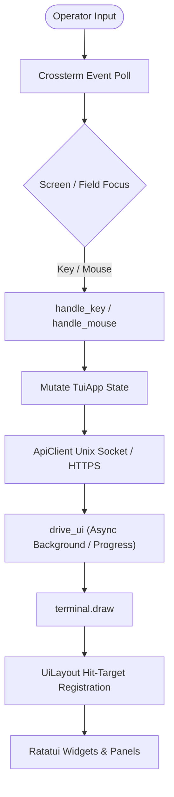

# TUI Module (`crates/tui/src/tui`)

> **Developer Reference Manual**
> This document details the architecture, design principles, invariants, and best practices for developing and maintaining the Terminal User Interface (`traffic-masq`) module.

---

## 1. Overview & Architecture

The `crates/tui/src/tui` module implements the interactive terminal client binary (`traffic-masq`) built on top of [Ratatui](https://github.com/ratatui/ratatui) and [Crossterm](https://github.com/crossterm-rs/crossterm).

The TUI serves as the primary operational console for the `traffic-masq` networking suite, allowing network operators to configure network interfaces, uplink DHCP clients, DHCP servers, Wi-Fi access points, Wi-Fi client connections, WireGuard VPN tunnels, and router provisioning without losing access to remote machines.

### Key Operating Modes

1. **Daemon Mode (Default):**
   - Communicates with `traffic-masqd` over a local Unix domain socket (`/run/traffic-masq/traffic-masqd.sock`) or verified HTTPS (`--server` / `--connection`).
   - Fully interactive: supports all tabs (Interfaces, DHCP Server, DHCP Client (configurable in Settings), Router, VPN, Wi-Fi, Settings, Logs).
   - Authenticated via shared device password; supports secure session caching in `$XDG_STATE_HOME`.
   - Interface/router applies, Wi-Fi client Connect, AP provisioning/profile activation, and operator-triggered Wi-Fi deactivation use commit-confirm rollback timers; standalone DHCP, Wi-Fi runtime controls such as reconnect/reload/passphrase updates, and VPN mutations apply immediately and rely on daemon-side ownership recovery.

2. **Direct / Recovery Mode (`--direct`):**
   - Directly binds to Linux Netlink via `RtnetlinkNetworkProvider`.
   - Read-only emergency inspection mode when `traffic-masqd` is down or unresponsive.
   - Restricts navigation to Dashboard, Interfaces, and Log; daemon-dependent tabs are rendered muted and keyboard section navigation skips them. Clicking a disabled tab still produces an informational warning.

---

## 2. Directory & Component Inventory

| File | Primary Responsibility | Key Types / Functions |
|---|---|---|
| [`mod.rs`](mod.rs) | Application lifecycle, main event loop (`run_loop`), async UI driver (`drive_ui`), key/mouse dispatch, terminal initialization & RAII cleanup. | `TuiApp`, `Screen`, `Section`, `TerminalGuard`, `run_tui`, `drive_ui` |
| [`layout.rs`](layout.rs) | Layout partitioning, panel wrappers, top header tab bar, bottom status & key hint footer, mouse hit testing primitives. | `UiLayout`, `panel`, `render_header`, `render_footer`, `point_in_rect`, `section_at` |
| [`confirmation.rs`](confirmation.rs) | Shared immediate-action confirmation presentation, mouse slots and modal detection. | `Dialog`, `current`, `key_for_slot` |
| [`input.rs`](input.rs) | Unicode-safe interactive text editing, shared clamped/wrapped focus navigation, blinking phase calculation, masked password span formatting. | `TextEditor`, `move_clamped`, `move_wrapped`, `render_value_with_cursor`, `render_masked_with_cursor` |
| [`session.rs`](session.rs) | Per-endpoint persistent session caching, XDG state management, strict file permissions (`0700`/`0600`, `O_NOFOLLOW`), zeroization. | `SessionStore`, `SessionPreferences`, `remember`, `SessionStore::restore` |
| [`dashboard.rs`](dashboard.rs) | Original Overview cards (mode, interfaces, pending, VPN); full-width interface list with per-interface RX/TX graphs and scrollable numeric statistics. No DHCP cards or sidebar. | `DashboardData`, `DashboardPane`, `TrafficHistory`, `TrafficSample` |
| [`interfaces.rs`](interfaces.rs) | Network interface list and editor; address ownership tags (`[ext]`, `[?]`), default route risk warnings, dry-run change plan previews. | `InterfaceEditor`, `InterfaceEditorField`, `render_interface_list`, `render_preview` |
| [`dhcp.rs`](dhcp.rs) | Downstream DHCP server configuration per interface, pool range validation, DNS settings, active lease viewer. | `DhcpEditor`, `DhcpField`, `DhcpLeasesView` |
| [`dhcp_client_editor.rs`](dhcp_client_editor.rs) | Saved DHCP client policy editor; immediate apply with error-preserving draft. | `Editor` |
| [`wifi_stations.rs`](wifi_stations.rs) | AP station inventory, active DHCP lease correlation and confirmed deauthentication. | `View` |
| [`provisioning.rs`](provisioning.rs) | Three-step whole-router Wi-Fi setup, complete replacement review and router confirmation flow. | `Wizard` |
| [`dhcp_client.rs`](dhcp_client.rs) | Uplink DHCP client supervision view with interface-name-based selection, scrolling, lease renewal/release, and defaults configuration. | `render`, `refresh`, `handle_key` |
| [`router/mod.rs`](router/mod.rs) | Router façade and shared state; route editing, controller/API orchestration, rendering, pending transaction views, and tests are split into `router/` submodules. | `RouterData`, `RouteEditorField`, `RouterPendingView`, `render_router` |
| [`wifi/mod.rs`](wifi/mod.rs) | Wi-Fi façade and shared state/model mapping; owns radio list behavior and re-exports screen handlers. | `WifiData`, `WifiRole`, `WifiEditor`, `WifiScanPicker`, `WifiProfileEditor`, `WifiConnectPrompt` |
| [`wifi/ap_profiles.rs`](wifi/ap_profiles.rs) | Saved AP profile menu, library, edit/delete/apply actions and deletion confirmation. | `WifiApProfilesView`, `open_ap_profiles`, `render_wifi_ap_profiles` |
| [`wifi/`](wifi) | Wi-Fi screen implementations split by responsibility: AP editor, scan picker, saved profiles, profile editor, connect/IP prompt, and Wi-Fi-specific tests. | `ap_editor`, `scan`, `profiles`, `profile_editor`, `ap_profiles`, `connect` |
| [`vpn.rs`](vpn.rs) | WireGuard VPN profile management, connection lifecycle, configuration import wizard, deletion confirmation. | `VpnData`, `VpnFocus`, `VpnImportEditor` |
| [`vpn_policy.rs`](vpn_policy.rs) | Policy routing rules for WireGuard (routing marks, table IDs, client bypass policies). | `VpnPolicyData`, `VpnPolicyEditor` |
| [`settings.rs`](settings.rs) | Daemon configuration, rollback timeout settings, session preferences, device password update wizard, security override reset. | `SecurityEditor`, `SettingsField`, `PasswordChangeEditor` |
| [`access.rs`](access.rs) | Remote HTTPS access configuration (TLS listen socket, certificate and private key file paths). | `AccessEditor`, `AccessField` |
| [`daemon_logs.rs`](daemon_logs.rs) | Bounded daemon log snapshots, severity/text filters, pause/follow and private export. | `View` |
| [`router_health.rs`](router_health.rs) | Saved router readiness and explicitly confirmed repair through provisioning APIs. | `View` |
| [`router_settings.rs`](router_settings.rs) | Physical uplink and global VPN chain editor feeding the shared router draft/plan. | `Editor` |
| [`connections.rs`](connections.rs) | Named HTTPS destinations; endpoint and CA-scoped session caches remain separate. | `SavedConnection` |
| [`logs.rs`](logs.rs) | Circular log buffer (`LOG_HISTORY_LEN = 500`) persisted per endpoint through `SessionStore`, severity levels (`Info`, `Warn`, `Error`), Ctrl+G popup viewer, log export. | `LogEntry`, `LogLevel`, `LogFocus`, `render_log` |

Client log history is stored in `$XDG_STATE_HOME/traffic-masq/client` (or `~/.local/state/traffic-masq/client`) using the same endpoint identity and private permissions as session preferences. Direct mode has a separate history. Logs survive credential expiration and logout. Dirty history is atomically saved on the blocking pool between UI operations and on loop exit, including error exits; clearing the log persists too. History retains up to 500 entries with a separate 4 MiB file limit; credential and preference files keep their 16 KiB limit. Storage failures appear in the client log and retry on the next new message.

---

## 3. Core Architectural Concepts & Invariants



### 3.1. The Async UI Driver (`drive_ui`)

In a terminal application, performing long-running network operations directly in the event loop causes the UI to freeze, drop keypresses, or fail to respond to window resizes. `traffic-masq` solves this with `drive_ui`:

1. **Non-blocking Polling Loop:** While awaiting a future (e.g. an API request or background status poll), `drive_ui` sleeps in 50ms intervals using `tokio::select!`.
2. **Snapshot-Based Progress Rendering:** On each 50ms tick, if an operation takes longer than 500ms, `render_operation_snapshot` draws a subtle progress banner:
   - Cancellable reads: `"Refreshing Xs. Displayed data may be stale; input interrupts refresh"`
   - Non-cancellable writes: `"Operation in progress Xs; rollback deadline in Ys. Q: exit after result; other actions disabled"`
3. **Cancellable vs. Non-Cancellable Operations:**
   - **Reads/Refreshes (`cancellable = true`):** If the user presses any key during a background refresh, the future is dropped immediately, returning the input event so the operator's action is processed without latency.
   - **Mutations/Applies (`cancellable = false`):** The TUI never cancels or retries network mutations. Ctrl+C also queues an exit until the response arrives. The client waits up to 65 seconds while the HTTP connection has a 60-second deadline. Admitted operations can continue beyond either deadline; a timeout leaves the outcome unknown and requires inspecting pending/current state. The UI permits pressing `q` to queue an exit after the response arrives, but blocks other inputs.
4. **Resize-Safe Progress Rendering:** At the same terminal size, the progress banner reuses the last rendered frame so footer/status context stays intact. After a resize, the stale snapshot is discarded and progress is rendered against the new geometry instead of replaying old coordinates.

### 3.2. Commit-Confirm & Immediate Mutation Flows

Because misconfiguring an IP address or firewall rule can sever SSH access, interface and router changes use a strict rollback pattern:
1. **Dry-Run Preview:** Before modifying transactional interface/router state, the daemon calculates a diff (`InterfaceChangePlan`, `RouterPlan`). The TUI presents this plan on a dedicated preview screen (`Screen::Preview`, `Screen::RouterPlan`).
   - Both previews use the same controls: scroll through the complete plan, press **Enter** on `[Apply temporarily]` only after reaching the end, or press **Esc** / `[Cancel]` to return without applying.
2. **Pending State (`Screen::PendingChange`, `Screen::RouterPending`):**
   - When the user confirms the plan, the change is applied with a daemon-managed rollback timer (e.g. 60 seconds).
   - The TUI transitions to a Pending screen displaying a live countdown timer:
     $$\text{Remaining} = \text{expires\_at\_unix} - \text{current\_unix\_time}()$$
   - Pressing **Enter** sends a commit request, making the change permanent.
   - Pressing **Esc** sends a rollback request; completion must be verified.
   - If the connection drops or the operator does not respond, expiry schedules daemon rollback. Admitted operations, retry cycles and commit uncertainty can delay or fence recovery; inspect pending state. See the [timing contract](../../../../docs/architecture.md#commit-uncertainty-and-confirmation-timing).
   - If rollback itself fails, the router pending screen switches to recovery mode: commit is removed, the `TM-REC-207` notice and individual failures are shown, **Enter** retries rollback, and **Esc** returns to the Router screen without discarding recovery state.
   - On the Router screen, degraded recovery shows the recovery code, invariant, blocked operation, action and runbook. Press **r** to retry a failed rollback; for `TM-REC-208` journal-cleanup-pending, cleanup retries automatically and **r** refreshes status.
3. **Disconnect Handling:** If the daemon becomes unreachable while on a pending screen, the TUI retains the pending change state and warns the operator that the outcome is unverified rather than falsely claiming success.

Standalone DHCP, Wi-Fi runtime controls such as reconnect/reload/passphrase updates, and VPN actions do not enter these pending screens and do not expose a commit timer. Live operator-triggered AP/client deactivation enters the pending-change screen. For an absent adapter, cleanup and durable intent saving return without a timer. Immediate mutations rely on the daemon's durable ownership/recovery mechanisms rather than TUI rollback state.

Immediate action confirmations share `confirmation.rs`: saved Wi-Fi/VPN profile
removal, offline interface Delete/Restore, router Repair, security Reset/Save,
Wi-Fi station disconnect, log clearing, and leaving interface/AP drafts or discarding router drafts. Each
view identifies its target and consequences and has named action / Cancel
buttons. Tab/Shift+Tab and arrows select an action; Enter executes the selected action;
Esc cancels. Background mouse targets do not change the action. Header navigation is blocked until the dialog closes.
These dialogs create no network transaction or rollback timer. Session
preferences save on the first Enter.

Applied Wi-Fi interface settings and credentials are independent of the profile
library. The daemon rejects deletion of a currently active client profile and
of a VPN profile in use. VPN deletion latches the name before confirmation so a
list refresh cannot change the target.

Missing-device interface edits use revision-checked Save rather than the live
preview/pending flow. The Delete saved settings and Restore settings from file buttons suppress base
intent or restore it. Inventory reports optional base-file metadata; an older
daemon without it cannot offer file restoration. Both support Tab/arrow navigation, Enter activation, and mouse clicks, with
Enter confirmation.
Router routes/sharing use saved inventory and latch the editor revision. Their
offline preview scrolls to **Save intent** and reports cleanup blockers separately
from persistence success. Unknown observation or a stale revision retains the
draft. Uplink/VPN-chain edits still require live router execution.

### 3.3. Screen and Section State Machine

Navigation is structured around 9 top-level **Sections** represented by the top tab bar:
`Dashboard` $\to$ `Interfaces` $\to$ `Dhcp` $\to$ `DhcpClient` $\to$ `Router` $\to$ `Vpn` $\to$ `Wifi` $\to$ `Settings` $\to$ `Log`.

- Every fine-grained `Screen` maps to its parent `Section` via `section_of(Screen)`.
- Left/Right arrows cycle through sections **only** when not currently editing an input field or trapped in a modal sub-flow.
- **Modal Isolation:** If an operator is inside an active editor or transaction sub-flow (for example `InterfaceEditor`, `WifiEditor`, `RouterPlan`), tab switching is prohibited until the user exits or completes the action.

### 3.4. Hit-Testing & Mouse Coordinates (`UiLayout`)

Mouse support is dynamically synchronized during the rendering pass:
- During each frame render, widgets register their active hit targets into `app.ui`:
  - `app.ui.tabs`: Array of `Rect`s for each section tab in the header.
  - `app.ui.buttons`: Vector of `(Rect, slot)` tuples for clickable action buttons.
  - `app.ui.list_area`: The bounding `Rect` of the current scrollable list.
  - `app.ui.list_row_height`: Height in terminal lines per row (e.g. 1 for simple items, 3 for DHCP clients).
  - `app.ui.list_scroll_offset`: Current viewport top index.
- When `handle_mouse` receives a click:
  - If inside `tabs`, it calls `navigate_to_section`.
  - If inside a button rect in `buttons`, it activates the corresponding slot.
  - If inside `list_area`, it translates the terminal row to the model index:
    $$\text{index} = \text{list\_scroll\_offset} + \frac{\text{mouse.row} - \text{list\_area.y}}{\text{list\_row\_height}}$$
- The shell supports terminals at or above $80 \times 24$. Below that size `app.ui.input_enabled` is `false` and all hit regions are wiped clean.
- After every screen renderer completes, `UiLayout::clip_interactions` intersects list/button hit targets with the central content viewport. Rendered overflow may be clipped visually, but it can never remain mouse-active in the header/footer.

### 3.5. Scroll Ownership and Review Screens

Mouse-wheel input on Dashboard, VPN, Router route/sharing lists, and Log returns focus to the list or viewport and clamps at its boundaries; it must not advance focus onto action buttons. Both interface and router plan reviews support wheel scrolling through the same handlers as Up/Down.

Scrollable screens own their viewport state explicitly instead of relying on Paragraph clipping. Lists register the visible `list_area`, `list_row_height`, item count, and model-level scroll offset in `UiLayout`. Interface and router plan reviews both keep explicit scroll/max-scroll state; Apply is accepted only after the operator has reached the end of the plan. Their pending screens share the same countdown and Confirm changes/Roll back now action layout; router pending additionally supports scrolling rollback diagnostics. DHCP Client selection is keyed by interface name, not by a shared list index, because dashboard interfaces and configured DHCP clients are different collections.

### 3.6. Text Input & Cursor Safety

Never manipulate UTF-8 strings by raw byte indexing. The helper `input::TextEditor` wraps `(&mut String, &mut usize)`:
- Indexes extended grapheme clusters with `unicode-segmentation`, so combining sequences move/delete as one visible character.
- Converts grapheme positions to UTF-8 byte ranges only at the mutation boundary; raw byte indexing is never exposed to screens.
- Active text fields bound the caret viewport by terminal-cell width with `unicode-width`, so long paths, wide glyphs, and identifiers do not push the caret off-screen.
- Password fields use the same grapheme count while rendering only mask characters.
- Provides `is_cursor_blink_visible()` based on 500ms intervals since Unix epoch.

### 3.7. Security, Zeroization & Session Storage

1. **Zeroization:** Structs storing sensitive passphrases (for example `PasswordChangeEditor`, Wi-Fi editors, and authentication buffers) implement `Drop` to call `.zeroize()` on underlying strings.
2. **Session Persistence (`session.rs`):**
   - Stored under `$XDG_STATE_HOME/traffic-masq/client/<endpoint-hash>.session.json`.
   - Local keys hash the canonical socket path (or absolute path if unavailable);
     HTTPS keys hash the normalized origin and SHA-256 of the trusted CA PEM bundle.
   - Named destinations live in `connections.profiles.json` in that directory
     and contain only the origin and optional absolute CA path.
   - File and directory permissions must be strictly verified: owner UID match, directory mode `0700`, file mode `0600`.
   - Must reject symlinks and open files with `O_NOFOLLOW`.
   - Writes are performed atomically using temporary files and directory fsyncs.
   - Changing the device password revokes sessions on the daemon; cached token files on other clients can remain on disk but no longer authenticate. If `$XDG_STATE_HOME` is absent or relative, storage falls back to the effective user's `~/.local/state`. Session preferences use a separate `<hash>.preferences.json` file in the same directory.

---

## 4. Best Practices for Modifying the TUI

When adding features, screens, or fixing bugs in `crates/tui/src/tui`, adhere to the following rules:

### Rule 1: Use Typed Enums, Never Magic Numbers
Do not use raw integers for button slots, action indices, or menu choices.
```rust
// BAD:
if slot == 2 {
    delete_profile(app).await;
}

// GOOD:
#[derive(Debug, Clone, Copy, PartialEq, Eq)]
pub(crate) enum WifiProfileAction {
    Activate,
    Edit,
    Delete,
}

impl WifiProfileAction {
    pub const ALL: [Self; 3] = [Self::Activate, Self::Edit, Self::Delete];
    pub fn from_index(index: usize) -> Option<Self> {
        Self::ALL.get(index).copied()
    }
}
```

### Rule 2: Isolate Left / Right Arrow Navigation While Editing
When an input field is being edited, `KeyCode::Left` and `KeyCode::Right` must move the text cursor within the field and **must not** switch top-level tabs.
- Always check `is_editing()` or whether a text field is active before dispatching section changes.

### Rule 3: Never Discard Operator Drafts on Background Refresh
The periodic background refresh in `run_loop` polls daemon data.
- If the operator is currently on an editor screen (`Screen::InterfaceEditor`, `Screen::WifiEditor`, etc.), **do not** overwrite form fields with remote status.
- Keep the draft intact until the operator explicitly cancels or submits.

### Rule 4: Always Check `direct` Mode Flags
If a feature relies on `traffic-masqd`:
- Verify `direct` mode in navigation and action handlers.
- If in direct mode, reject the operation gracefully with:
  ```rust
  app.push_message(
      LogLevel::Warn,
      "This operation requires the daemon API; unavailable in direct/offline mode",
  );
  ```

### Rule 5: Keep Hit Targets Synchronized with Rendering
If you render a button or clickable row:
- Register its bounding `Rect` and index into `app.ui.buttons` or `app.ui.list_area` in the **same** render function.
- If the widget is conditionally hidden, do not register the hit rect.

### Rule 6: Implement RAII Drop Cleanups for Sensitive Data
If a struct holds Wi-Fi passphrases, private keys, or passwords:
```rust
impl Drop for MySecretEditor {
    fn drop(&mut self) {
        self.passphrase.zeroize();
    }
}
```

### Rule 7: Update All Routing Matrices When Adding a Screen
When adding a new `Screen` variant:
1. Add to `enum Screen` in `mod.rs`.
2. Map it to the appropriate section in `section_of(Screen)`.
3. Provide keyboard shortcuts in `layout::screen_help_pairs(Screen)`.
4. Handle rendering in `render(...)` in `mod.rs`.
5. Route key events in `handle_key(...)` in `mod.rs`.
6. Route mouse events in `handle_mouse(...)` in `mod.rs` if interactive.

---

## 5. Testing Patterns

The TUI module utilizes `ratatui::backend::TestBackend` extensively for deterministic, offline testing without needing an active terminal or root privileges.

### Pattern 1: Testing Layouts and Text Output
Verify that rendered widgets contain expected text, correct styling, and accurate row placements:
```rust
#[test]
fn test_screen_rendering() {
    let mut terminal = Terminal::new(TestBackend::new(80, 24)).unwrap();
    let mut app = TuiApp::default();
    
    terminal.draw(|frame| render(frame, &mut app, false)).unwrap();
    
    let buffer = terminal.backend().buffer();
    let row_text: String = (0..80).map(|x| buffer[(x, 2)].symbol()).collect();
    assert!(row_text.contains("Interfaces"));
}
```

### Pattern 2: Testing Hit Regions & Button Rects
Ensure clickable elements have valid coordinates that stay within viewport boundaries:
```rust
#[test]
fn test_preview_cancel_button_click_target() {
    let mut app = TuiApp::default();
    // Configure app state...
    let mut terminal = Terminal::new(TestBackend::new(80, 24)).unwrap();
    terminal.draw(|frame| render_preview(frame, frame.area(), &mut app)).unwrap();

    let (rect, slot) = app.ui.buttons.iter()
        .find(|(_, slot)| *slot == 1)
        .expect("Cancel button must have a hit target");
    assert!(rect.y < 24);
}
```

### Pattern 3: Testing Keyboard State Machines Offline
Pass a dummy socket client (`ApiClient::new("/nonexistent.sock")`) to test state transitions without network calls:
```rust
#[tokio::test]
async fn test_editor_navigation() {
    let mut app = TuiApp::default();
    let client = ApiClient::new("/nonexistent.sock");

    handle_editor_key(&mut app, KeyCode::Char('a'), &client).await;
    assert_eq!(app.editor.as_ref().unwrap().cursor, 1);
}
```

### Pattern 4: Terminal Resize & Clipping Verification
Verify that reducing terminal dimensions below $80 \times 24$ properly degrades into a warning banner and wipes hit targets:
```rust
#[tokio::test]
async fn resize_clears_hit_regions() {
    let mut terminal = Terminal::new(TestBackend::new(40, 10)).unwrap();
    let mut app = TuiApp::default();

    terminal.draw(|frame| render(frame, &mut app, false)).unwrap();

    assert!(app.ui.buttons.is_empty());
    assert!(app.ui.list_area.is_none());
    assert!(!app.ui.input_enabled);
}
```

---

## 6. Common Pitfalls & Troubleshooting

- **Terminal Left in Raw Mode on Crash:** If developing outside the standard harness, ensure `TerminalGuard` dropped cleanly. If a test or development binary panics before teardown, run `reset` in your shell.
- **Lost Rollback Context:** After a daemon restart, a cached session may no longer authenticate and the pending token may have been recovered or retired. Reauthenticate and inspect pending/current state; a lost response or expired timer does not prove success. Stopped recovery requires explicit retry, and device events do not renew its budget.
- **Double-Draw Artifacts:** Do not invoke `terminal.draw` inside sub-functions. All rendering must originate from the top-level `run_loop` or the snapshot callback in `drive_ui`.
- **UTF-8 Panic on Slicing:** Avoid `&str[..cursor]`. Use `input::TextEditor` for editing; a grapheme cursor cannot safely be treated as a byte or Unicode scalar index.

### UX safeguards

- Ctrl+K opens modal context help, including a first-setup checklist. Ctrl+G remains the operation-message viewer.
- Below 80x24, an active confirmation deadline is shown with Enter to commit and Esc to roll back. Other editing remains disabled.
- AP editor consequences stay pinned below the scrolling fields. A `*` marks edited settings; Esc offers keeping a session draft, discarding it,
  or continuing editing. Interface and AP drafts retain their original revision
  and stay memory-only. AP draft credentials still zeroize on drop.
- Load profile opens a selectable list. Save edited settings before loading another profile or applying a loaded profile.
- DHCP's Apply DHCP now action changes the running service immediately, without a confirmation timer.

### Dashboard data and layout

Independent status reads preserve partial results and label unavailable data explicitly. Failed interface reads retain the previous interface list and traffic history, without recording artificial samples. Successful refreshes preserve selection by interface name; the initial selection favors a configured WAN or default-route interface. DHCP is refreshed only in its dedicated screens.

The traffic view uses the original per-interface headers and independently scaled RX/TX graphs. Areas shorter than 14 rows use compact one-line rows. Lists scroll with selection in both layouts. Statistics wrap by grapheme width and use PgUp/PgDn to expose all rows. Aggregate counters are explicitly identified as sums, not Internet usage. VPN interface/policy status does not imply a successful handshake or connectivity probe.

### Rebuilding the documentation walkthrough

The ignored recorder runs a single live TUI session against a stateful local mock
API. It sends only keyboard events through the production input handlers,
polls status in the background, and captures the rendered terminal every 50 ms.
It records typing, focus, scrolling and real countdown updates;
it never replaces screens or editor values to stage individual screenshots.
The mock API keeps all network changes inside the recording process.

The session uses 120×30 cells. Recording takes about two minutes in real time.
The Pillow renderer keeps the recorded frame durations and draws a normal
16-pixel monospace font, with keyboard input hints and no mouse pointer:

```sh
TRAFFIC_MASQ_DEMO_DIR=/tmp/traffic-masq-recording cargo test -p traffic-masq-tui --lib export_walkthrough -- --ignored --nocapture
python3 packaging/render-tui-demo.py /tmp/traffic-masq-recording docs/media/tui-demo.gif
```

`timeline.json` contains the frame durations and chapter timestamps; identical
consecutive frames share a duration. The generator updates the GIF chapter index.
Use `--preview-dir /tmp/tui-preview` to inspect PNG frames, or `--video /tmp/tui.mp4`
to also encode a continuous 20-fps MP4 with ffmpeg. A directory of standalone
screenshots is not accepted as a recording. Keep the recording directory specific
to this run.
