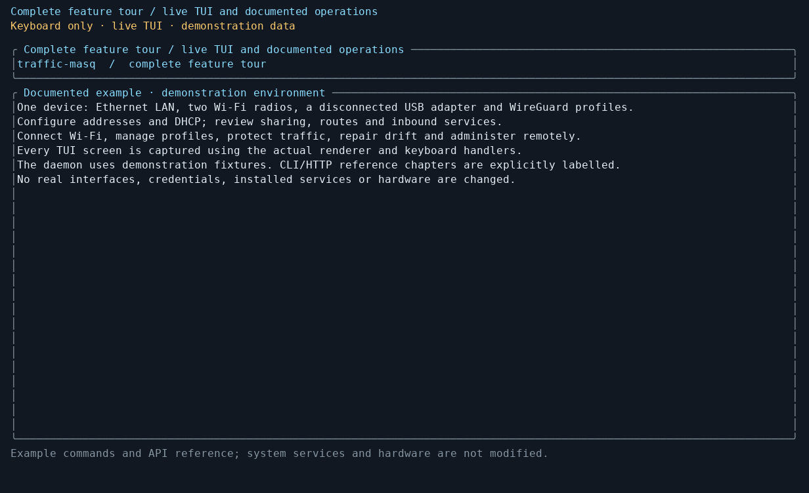

# Operating guide

## Interface walkthrough



## Requirements

#### Network manager conflicts

Before configuring an interface, release it from any other network manager or
independent DHCP/Wi-Fi service. Distribution defaults vary, and competing
services can reclaim interfaces or overwrite addresses and routes. Follow
[Avoiding conflicts with distribution network managers](resource-conflicts.md#avoiding-conflicts-with-distribution-network-managers)
for detection, persistent exclusions, handover and verification after reboot.
An externally managed WAN can remain with its current manager when used only as
an existing uplink.

## Build

- Rust toolchain with Cargo
- a C compiler (`cc`, `gcc` or `clang`)
- `cmake`, on targets other than `x86_64-unknown-linux-gnu`

A C compiler is needed for two dependencies: the default `rustls` cryptography
backend uses C and assembly, and `sqlx` builds SQLite from source. On
`x86_64-unknown-linux-gnu` both invoke the compiler directly. Other targets use
CMake for the cryptography backend.

The supported build toolchain is Rust 1.95.0, pinned in `rust-toolchain.toml`.

### Runtime

- Linux
- root access for `traffic-masqd`
- kernel support for nftables when using routing/firewall features, and WireGuard when using VPN
- `nft` in `PATH`, built with JSON support
- two or more network interfaces for router operation
- `hostapd` for Wi-Fi access point mode
- `wpa_supplicant` for Wi-Fi client mode

The firewall is read back as JSON (`nft --json list ruleset`), so an nftables
built without libjansson fails at the first firewall change rather than at
startup.

`hostapd` and `wpa_supplicant` are looked up at absolute paths, not through
`PATH`. The defaults are `/usr/sbin/hostapd` and `/usr/sbin/wpa_supplicant`;
`wifi.hostapd_binary` and `wifi_client.wpa_supplicant_binary` can be set in the
configuration file. AP channel/width validation reads PHY capabilities and
global/device-specific regulatory domains directly through the kernel nl80211
Netlink API. `iw` is optional for diagnostics and physical test harnesses.
Incomplete or interrupted probes reject AP validation instead of assuming
channels are usable. Regulatory dumps require a kernel supporting
`NL80211_CMD_GET_REG` with `NLM_F_DUMP`.

WireGuard is configured over netlink, and both DHCP server and DHCP client are
part of the daemon, so `wireguard-tools`, `dhcpcd` and `dhclient` are not used.
The DHCP client requires root or `CAP_NET_RAW`.

## Build

```sh
cargo build --release --locked
```

The binaries are written to:

```text
target/release/traffic-masq
target/release/traffic-masqd
```

## Test

The default tests need no privileges and do not change the host network:

```sh
cargo test --locked --workspace
cargo doc --locked --workspace --no-deps
cargo test --locked --workspace --doc
```

Run the eight network and VPN suites through the isolated runner:

```sh
sh packaging/test-namespaces.sh
# To run only the VPN suites:
sh packaging/test-namespaces.sh vpn_wireguard_namespace vpn_policy_namespace
```

You need Linux, iproute2, nftables, iputils-ping, wireguard-tools, ethtool, `udhcpc`,
Python 3, util-linux and coreutils. Cargo builds as your user. Each suite then
runs in its own network, mount and PID namespaces, with private `/run`, `/proc`
and `/sys` mounts. A suite has ten minutes to finish; on exit, its remaining
processes are terminated.

The runner uses an unprivileged user namespace by default. If the host disables
user namespaces, use a disposable VM and run
`sh packaging/test-namespaces.sh --sudo`. This needs a valid sudo session or
passwordless sudo. Only test execution is elevated; Cargo still runs as your
user. Missing tools or kernel features fail the run instead of skipping tests.

VPN tests cover a real WireGuard handshake, tunnel traffic, policy changes,
blocked direct uplink traffic, tunnel teardown and reconnection. The runner
excludes Wi-Fi simulation and physical hardware tests.

Wi-Fi namespace tests also need `modprobe`, `modinfo` and `mac80211_hwsim`.
To compare the native AP capability probe against `iw` on a selected radio
without changing its state:

```sh
TRAFFIC_MASQ_NL80211_INTERFACE=wlp1s0 TRAFFIC_MASQ_IW_BINARY=/usr/bin/iw \
  cargo test --locked -p traffic-masq --lib native_probe_matches_iw_on_selected_radio -- --ignored
```

Physical tests use `TRAFFIC_MASQ_*` variables for interfaces, SSIDs and PSK files.
The physical runner accepts an explicit adapter. Inspect its kernel identity
through the daemon's network provider without changing the connection:

```sh
sh packaging/test-wifi-physical.sh --interface wlp1s0 --suite inspect
```

To test actual WPA2 association with the daemon and wpa_supplicant, supply
the network SSID and an absolute path to a regular password file with mode
0600. Authenticate sudo in your terminal first; Cargo builds as your user:

```sh
sudo -v
sh packaging/test-wifi-physical.sh --interface wlp1s0 --suite client \
  --ssid 'your-network' --psk-file /absolute/path/to/wifi-password --sudo
```

`--suite ap` uses the same arguments for a hostapd AP test and requires an
external station to connect during the test. Client/AP tests temporarily move
the selected PHY into a network namespace and return it during cleanup. They
refuse the current best-route interface and a PHY with other named interfaces.
The inspection suite does not test association, scanning or AP startup.

The default `functional` suite needs no Wi-Fi password. It starts a real daemon
on the selected radio in a temporary namespace, scans nearby networks through
the same HTTP API as the TUI, previews/applies/commits `198.18.0.1/24`, verifies
the actual kernel address, then removes it and confirms removal. Run within
range of an AP; an empty scan fails this functional check.

```sh
sudo -v
sh packaging/test-wifi-physical.sh --interface wlp1s0 --sudo
```

Some need Internet access, a second radio or someone to unplug a cable. Read
the selected test's setup and use a disposable host. Do not run all ignored
tests together on your workstation.

## Install

Build or unpack a release with both binaries in the same directory, then run:

```sh
sudo ./traffic-masqd install
```

The installer uses an English-language wizard. Its defaults grant TUI access
to the user who invoked sudo (or root alone if that user is unknown), select
routing dependencies, install missing packages, start the daemon and enable
boot autostart. Advanced settings and password setup are deferred. Review the
plan at the final prompt before applying it.

Set the password afterward with `sudo /usr/local/bin/traffic-masq`. Initial setup
requires a local root client; there is no default password. Select Wi-Fi or
WireGuard dependency presets if needed. Enter presets as one comma-separated
list (`router,wifi-ap`, for example), or `none` to skip dependency checks.
Presets install prerequisites only;
network features remain disabled until you configure them.

For unattended installation, specify user access and password setup:

```sh
sudo ./traffic-masqd install --non-interactive --user alex \
  --dependency-presets router,wifi-ap --install-deps \
  --password-file /run/secrets/traffic-masq-password --start
```

Use `--skip-user-access` for root-only access, or `--defer-password` to set the
password later. The default dependency preset is `router`. Unattended installs
leave dependency installation and immediate startup off unless requested.

The default prefix is `/usr/local`; change it with `--prefix`. The daemon's
global `--config` option defaults to `/etc/traffic-masq/config.toml`.
Use `--dry-run` to inspect the plan without changing the machine.
Password files must be regular, non-symlink files with no group or other access;
their contents never appear in arguments, plans, logs, or errors.

The installer preserves existing configuration, credentials, profiles, state,
and ownership journals. It refuses replacement while the daemon is running and
refuses a conflicting configured socket group. A newly created configuration
manages no interfaces. Adding a user to `traffic-masq` requires signing out and
back in before that session can access the socket.

The installer supports apt, dnf and pacman. With other package managers it lists
what to install manually. On apt systems, install missing Wi-Fi packages yourself:
their package hooks may start services that compete with traffic-masq.

DHCP is built in and WireGuard uses netlink, so the installer adds neither DHCP
clients nor `wireguard-tools`. Kernel feature checks are advisory: a feature
may be available even if its module is not loaded yet.

`--init-system auto` (the default in both modes) detects the running init system
and registers boot autostart independently of `--start`. In a container or on an
unrecognized init system, auto leaves startup manual and says so in the plan.
Use `--init-system systemd|openrc|runit|sysv` to select one explicitly, or
`--init-system none` to omit integration (and remove a previous installer-owned
registration). `--start` starts through the selected manager and waits for API
readiness. Runit enables and starts simultaneously, so its registration requires
`--start`; `--runit-service-dir PATH` selects an existing scan directory if needed.

The compatibility `packaging/install.sh` forwards command-line flags to the daemon
for host installation. `DESTDIR`, `PREFIX`, and `BINARY_DIR` still provide
side-effect-free binary package staging: staging never discovers, enables, or
starts host services. See [init integration](../packaging/INIT.md) for lifecycle,
file ownership, recovery, and native commands.

The manual compile workflow builds an archive containing both binaries. Use the
local release script to produce a versioned archive and SHA-256 checksum. See
[release procedure](release.md). Target machines do not need Rust
or a C compiler.

The installer prints a read-only network conflict report before asking questions,
including in unattended and dry-run mode. It checks saved managed interfaces again
when an existing configuration is selected, and repeats the scan after installing
packages because package hooks can start networking services. Findings do not
block installation: a fresh configuration manages no interfaces, and existing
services may legitimately provide the WAN. Follow the report's interface-specific
handover advice before enabling network features. No foreign service is stopped
and no interface is released automatically. The final summary prints commands
using the actual installation prefix, configuration path and API socket.

## Reset all settings

To return traffic-masq to a clean, safe configuration while keeping the installation itself:

```sh
sudo traffic-masqd reset --dry-run
sudo traffic-masqd reset
```

The reset command requires a healthy running daemon for the normal path. It requests restoration of traffic-masq-owned network state, stops the daemon, and requires a matching shutdown acknowledgement before deleting recovery/ownership journals. It then clears traffic-masq persistent state (runtime overrides, credentials and sessions, DHCP lease state, Wi-Fi state/profiles, VPN profiles and ownership journals) and replaces the selected configuration with safe defaults. Installation/runtime paths and the socket access group are preserved so the installed service remains usable. Logs, binaries and init-service registration are preserved, and the daemon is left stopped. Start it explicitly when ready:

```sh
sudo traffic-masqd start
```

Use `--yes` for non-interactive reset. Destructive state directories are checked before deletion; shallow paths and symlinked paths are refused. A stopped or unhealthy daemon is refused by default because the command cannot prove that owned kernel state was restored. After a reboot (or when live traffic-masq-owned kernel state is otherwise known to be clean), `--force-offline` explicitly permits reset while the daemon is stopped.

## Configuration

Create the default configuration file:

```sh
sudo traffic-masqd config init
```

Default path:

```text
/etc/traffic-masq/config.toml
```

Validate the configuration:

```sh
sudo traffic-masqd config validate
```

Print the selected configuration:

```sh
sudo traffic-masqd config show
```

Configuration lookup order:

1. `--config <path>`
2. `TRAFFIC_MASQ_CONFIG`
3. `/etc/traffic-masq/config.toml`
4. built-in defaults

An explicitly selected file (`--config` or `TRAFFIC_MASQ_CONFIG`) must exist
and be readable; errors do not fall back to another source. The built-in
defaults do not manage network interfaces.

`config show` prints the selected file configuration (with defaults filled in),
not the runtime overrides saved by the TUI or API. Inspect the effective
interface/router settings through the TUI or API. `config validate` validates
the file configuration; it does not test live connectivity.

An Internet-sharing configuration example is available at
[`examples/config.toml`](../examples/config.toml). Replace all interface names and
addresses before use. See the [configuration reference](configuration.md) for
all supported sections, optional fields, defaults and Wi-Fi/DHCP examples.

The daemon also exposes a versioned JSON API on its Unix socket and, when
explicitly enabled, over HTTPS. See the [HTTP API reference](api.md) for
authentication, every route, request schemas, and transaction handling.

## Start

Start the daemon in the background:

```sh
sudo traffic-masqd start
```

Check its state:

```sh
sudo traffic-masqd status
```

Open the terminal client for initial password setup:

```sh
sudo traffic-masq
```

Later sessions may run without root if the user can access the daemon socket:

```sh
traffic-masq
```

## Terminal client

### Login and sessions

The client asks for the device password inside the TUI. By default, it remembers
its session for **5 minutes from password entry**, including across client restarts.
In **Settings**, toggle **Remember session**, edit **Remember for (minutes)**
(1–1440), then choose **Save session preferences (applies now)**. Disabling this
removes the saved token and requires a password on the next launch. These are
per-user, per-endpoint preferences and do not require a daemon restart.
Local caches identify the socket path; remote caches identify the HTTPS origin
and trusted CA bundle.

Only a session token is saved, never the password. Files are private (`0600`) in
`$XDG_STATE_HOME/traffic-masq/client` (normally `~/.local/state/traffic-masq/client`),
inside a `0700` directory. Reopening the client does not extend the chosen duration.
The daemon still validates the session: password changes, revocation, and its
configured idle/absolute limits can require a password sooner.

### Navigation

The TUI keeps operation messages visible; press Ctrl+G to read a full message and
use Up/Down to scroll it. Tab/Shift+Tab moves focus forward/backward;
Ctrl+P/Ctrl+N selects the previous/next main tab. Ctrl+C exits after any in-flight
action completes. Finish a form or leave it with Esc before changing
tabs. Long Wi-Fi lists scroll with the selection; deleting a profile requires
an explicit confirmation naming the profile. Enter activates the selected dialog
button, Tab/Shift+Tab or arrows moves focus, and Esc cancels. PgUp/PgDn or the
wheel scrolls long confirmation details while the action buttons stay visible. Buttons also accept
mouse clicks. In text fields, typing edits the value and Left/Right moves the
cursor. Review pages use Up/Down, PgUp/PgDn, Home/End and the wheel to scroll.

The interface editor keeps IPv4, router participation, configuration ownership
and **Generate MAC automatically** in the main view. Automatic generation is
initially checked for new interfaces; existing saved policies are preserved.
Uncheck it and open **Advanced** to enter a fixed MAC or generate a fixed address
once. See [MAC policy and rotation rules](configuration.md#interface-mac-address).
Help follows the selected field, and **Review changes** stays at the bottom.
Leaving a changed interface or AP editor offers **Keep draft**, **Discard edits**, or **Continue editing**. Drafts
remain in memory for this TUI session, including entered AP credentials; reopen
the same interface or AP profile to resume. Closing the TUI loses these drafts.
Background refresh and API failures preserve the active draft.

Live interface, router, Wi-Fi client and AP edits follow
**Editing → Review changes → Apply temporarily → Confirm changes**. Review shows
what will change while the network is still unchanged. After applying, verify
connectivity, then choose **Confirm changes** or **Roll back now**. Without
confirmation, the countdown schedules daemon rollback. Rollback failures retain
recovery details. Ctrl+G opens the full operation result.

### Routes and Internet sharing

In **Route**, Tab/Shift+Tab switches between routes and **Actions**. Up/Down
or Left/Right selects an action, and Enter or Space activates it. Esc returns
to the route list. Scrolling the route list keeps focus in the list.
Buttons wrap to fit the terminal. For a route outside the static route editor,
**Delete manually** (or Del on the selected route) displays an `ip -4 route del`
command to run on the daemon's machine. The TUI never executes that command or
changes the proposed configuration for that route. After running it, choose
**Refresh**. DHCP or another network manager may recreate the route; a lasting
change belongs in the configuration that creates it. Deleting a traffic-masq
static route continues to stage the change for **Plan / Apply**.

For traffic-masq DHCP routes, the manual deletion dialog also explains the
supported configuration path. For a default route, use **Edit route** or
**DHCP Client → interface → e / Enter**, turn **Install default route** off,
and Apply and confirm the change. **Route metric** changes its priority instead.
The local subnet route follows the leased address and has no separate disable
switch; changing away from DHCP belongs in the confirmed Interfaces editor.
Manual deletion changes only the live kernel state, has no automatic rollback,
and may be undone by the DHCP client.

The **Route** tab has four sections, selected with **1 / 2 / 3 / 4** or by clicking
its section labels:

- **Routes** edits destinations, gateways, interfaces, tables and metrics.
- **Internet sharing** lists independent connections in **From / Through / NAT /
  Source subnet** columns. Select a row and **Edit**, or choose **Add** or **Delete**.
  Up/Down selects rows; Tab switches to actions; Left/Right selects an action.
- **Topology** shows configured connections and observed default routes. This is
  a configuration overview, not a verified packet path.
- **Port forwarding** maps incoming IPv4 TCP/UDP ports to another host, with
  optional external IPv4 and source subnet restrictions.

In the sharing editor, choose **Traffic from**, **Internet through** and
**Masquerade**. **Advanced** reveals the optional IPv4 **Source subnet**; leaving
it empty means any source. A scope such as `192.168.10.0/24` restricts both
forwarding and NAT. Enter on **Save connection** stages the change. Editing an
existing connection replaces that row, including when its interfaces change.
Esc cancels the current editor without discarding earlier staged changes.

From a selected route, press **n** or **Share via: n** to start a new sharing
connection with the route's output interface filled in. The resulting rule is
independent of the route: changing or deleting that route does not rewrite the
sharing rule.

Routes and sharing use the same draft. **Review / Apply** (or **Plan / Apply**
in Routes) previews all pending edits before applying them with a confirmation
timer. Refresh keeps your draft.

Saving a sharing connection creates routing intent automatically. Review,
apply and commit the draft; no separate router enable switch is required.

For inbound services, open **4 Ports**. Choose **Add**, enter the incoming and
target interfaces, TCP or UDP, the external port and the internal IPv4/port.
Optional external IPv4 and source subnet fields limit the mapping. Choose
**Save port forward**, then **Review / Apply** and commit the transaction.
Use **Edit** or **Delete** on a selected mapping to stage a change. See
[Port forwarding](configuration.md#port-forwarding) for the TOML/API fields,
return-route requirements and supported scope.


Connections refer to existing interfaces, including externally managed Ethernet
and VPN interfaces. Both must be up when applying. Creating a connection does
not take ownership of interface addresses, set up Wi-Fi, or configure DHCP.
Each source may have several allowed destinations. Return traffic for established
connections is allowed; other IPv4 forwarding to/from configured source
interfaces is blocked. Other interfaces and foreign firewall tables remain
outside these rules.

The equivalent configuration is:

```toml
[router]
forwarding = [
  { from = "lan0", to = "wan0", masquerade = true },
  { from = "lan1", to = "wg0", masquerade = true, source_subnet = "192.168.10.0/24" },
]
```

Routes determine which allowed destination a packet actually uses. Masquerading
rewrites the source address on egress; it does not select routes or nest VPN
encapsulation ([nftables NAT documentation](https://wiki.iptables.org/wiki-nftables/index.php/Performing_Network_Address_Translation_%28NAT%29)).
An `Ethernet → VPN → VPN → Internet` path also needs the tunnels and their
endpoint/policy routes configured. This editor manages forwarding/NAT between
existing interfaces. Use **Uplink / VPN** for the VPN-chain editor. Set explicit
sharing rules for the intended interface pairs; the uplink and VPN chain do not
synthesize connection rules. Global VPN policy must be direct when explicit
connections are configured.

Omitted `forwarding` and `forwarding = []` grant no connection permissions.
`uplink` can select Wi-Fi/DHCP client services and the VPN chain's physical
upstream independently of forwarding rules.

### Physical uplink and global VPN chain

**Route → Uplink / VPN** (**u**) edits the current router draft. Set the uplink
interface name and choose External (unmanaged Input) or DHCP (managed Input with
an enabled DHCP client). Those interface prerequisites are configured in
Interfaces/DHCP Client; this editor preserves their settings.

Select imported VPN profiles, add them at the LAN end, select a hop and move it
closer to the physical uplink or LAN, or remove it. The first hop connects through
the physical uplink; each later hop connects through the preceding tunnel. The
last hop protects LAN traffic. The daemon validates chain size and profiles.

Uplink and chain edits preserve explicit sharing rules. Configure permitted
connections in Internet sharing, including the VPN egress. An uplink or chain
alone adds no forwarding or NAT permissions. The shared plan shows both old and
new hops and removed sharing rules. Esc from the editor preserves the
pre-existing draft; staging uses the usual confirmed router flow.
Uplink/chain changes require a live transaction, not an offline intent save.

The **Route router's own traffic through VPN** checkbox (Enter toggles it) sends
traffic generated by the router itself, not only forwarded LAN traffic, through
the chain. It needs at least one hop. The plan shows the change, and Apply/Commit
and the rollback timer work as for any other router change. The tunnel endpoints,
loopback, LAN subnets, DHCP and multicast stay direct; other IPv4 may only leave
through the tunnel. IPv6 from the router is blocked except loopback, link-local
and multicast traffic. The router's DNS resolver must be reachable through the
VPN.

### Daemon log viewer

The Log tab still contains the local session log. **2** opens the authenticated
daemon log viewer, **1/Esc** returns. **/** edits a case-insensitive substring
filter (including subsystem names); Enter finishes editing. **l** cycles an exact
severity filter. **r** refreshes the snapshot. Up/PgUp/Home pauses automatic
refresh so the displayed history stays stable; End resumes following. The viewer
marks stale snapshots and limited history explicitly. **e** exports the filtered
snapshot, source filenames, destination and observation status to a local file
with mode 0600. It does not clear or change daemon log files.

### HTTPS connections and saved destinations

Use `traffic-masq --server https://host:port [--ca-cert /path/to/ca.pem]` after
enabling HTTPS on the daemon and restarting it. Initialize the device password
locally before connecting remotely. The CA file belongs to the client machine;
the certificate/key configured in Remote access belong to the daemon machine.
The URL hostname or IP must match the server certificate's subject alternative
names. TLS verification is mandatory; redirects are not followed.

Without `--ca-cert`, trust is loaded from `SSL_CERT_FILE` when set, otherwise the
first available standard Linux CA bundle under `/etc/ssl` or `/etc/pki/tls`.
For a private/self-signed server, supply its CA/certificate explicitly.

Add `--save-connection NAME` to save the destination and exit. Use
`--connection NAME`, `--list-connections`, or `--delete-connection NAME` later.
Names use 1–64 ASCII letters, digits, dots, underscores or hyphens. Saving an
existing name updates it. CA file paths are saved as absolute paths; connection
profiles contain no passwords or tokens. Profiles use a private JSON file under
the same per-user state directory as session preferences. Deleting a destination
removes the local profile; it does not revoke server sessions.

The regular remembered-session policy also applies over HTTPS. Each origin and
trusted CA bundle has its own cache key, so changing trust requires authentication
again. The server is shown on the login screen and TUI header. `--change-password`
works with either `--server` or `--connection`. Direct recovery mode always
observes the local host and cannot be combined with a remote destination.

### Connected AP clients

**Wi-Fi → output/AP radio → Connected devices** lists associated stations and
joins active DHCP leases by MAC on that interface. DHCP IP/expiry are unknown
when the device uses a static IP or leases are unavailable. Hostapd signal,
connected time and RX/TX byte counters are shown when provided. Refresh preserves
selection by MAC; failed observations retain rows with a stale/unavailable label.

**r** refreshes, **d** asks to disconnect the selected client, Enter confirms,
and Esc cancels. This is deauthentication, not a persistent block. The selected
MAC is held during confirmation and background refresh is paused for that dialog.
Tab selects the refresh/disconnect/back buttons; scrolling selects the list.

### DHCP client policy editor

Enable the DHCP Client tab in Settings if hidden. Select an interface and press
**e** or Enter to load its saved DHCP policy. Edit the route metric and toggle
installation of the default route, requesting DNS, and sending Release on
shutdown. Changing the route metric or default-route installation on an enabled
client uses the interface transaction and requires confirmation before its
rollback timer expires. Cancel or timeout restores the previous DHCP policy
through convergence; lease state is managed by the DHCP supervisor. Initial
enablement and changes to other options remain immediate. Errors retain the
draft. Esc discards it. **c** on the list
continues to enable/reset the client to defaults.

### Settings and running operations

Changes in **Settings** also require confirmation. The first Enter shows an
indented `Note: Confirm...` line; the second Enter applies the selected change.
Esc or moving to another setting cancels the confirmation. Explanatory text is
shown as an indented `Note:` directly after the setting it describes.

During an API refresh, input takes priority. While an action is in progress,
the TUI shows its elapsed time and rejects additional actions; Q requests exit
after the result. A timeout does not prove that a change failed: inspect the
current state before retrying. An expired session offers login again without
discarding drafts or extending rollback deadlines. Terminals smaller than 80×24
disable normal editing and mouse controls; Q still exits. An active confirmation
deadline remains visible, with Enter to commit and Esc to roll back. Recovery
states show their available recovery actions instead.

### Wi-Fi client connections

Assign each wireless interface a managed role in **Interfaces** first:
**input** permits Wi-Fi client actions, and **output** permits access point actions.
Wi-Fi provisioning preserves that role and rejects missing or incompatible roles.
The Wi-Fi screen also offers standalone **Saved client profiles** and
**Saved AP profiles** libraries, even with no interfaces. Create, edit, and delete
profiles there; select a compatible interface to connect or apply a profile.

Open a radio to see its connection, SSID, observed IPv4 and saved IPv4 policy.
Client actions put **Scan networks**, **Connect saved profile**, and **Disconnect**
first. Selecting a saved profile opens its IPv4 form directly. AP actions put
**Configure access point** and **Connected devices** first.

Tab/Shift+Tab moves through radio actions; Esc returns to the same radio. Lists
and connection forms keep the selection visible. In the connection form, arrows
move focus and Enter/Space selects an IP option. The selected policy is shown
above the choices. Use **Review changes** or Ctrl+O to open the review, then
**Apply temporarily** to submit. This provisions the profile, credentials and
IPv4 policy together as a tentative change. Verify connectivity, then commit
before the deadline. On failure, inspect the reported pending/recovery state
before retrying. **Keep current static IP** uses the configured address, never a
currently observed DHCP lease.

Client **Connect** sends the profile and IPv4 policy to
`PUT /api/v1/wifi-client/{interface}/provision`. The backend stages the interface,
credential, Wi-Fi and DHCP state together and returns `NetworkChangePending`.
Confirm the candidate only after checking connectivity. Failure or rollback
restores the preceding configuration and credential. DHCP mode reuses existing
route/DNS policy; switching to static disables DHCP without discarding it.

The `active-profile` activation and deactivation endpoints are also tentative:
they return `NetworkChangePending` and must be committed after connectivity is
verified. Internal autoconnect uses a separate immediate activation path; the
provisioning endpoint remains the preferred interactive flow when IPv4 policy
must change together with the profile.

### Wi-Fi access points

The Wi-Fi screen includes unconfigured radios. Assign a managed **output** role
first, then **Configure access point** accepts an IPv4 subnet and configures the
AP in one backend transaction. DHCP
policy explicitly selects preserve, enable/configure, or disable. **Apply** is
tentative: verify connectivity and commit before the rollback timer expires.
**Saved AP profiles** uses the same navigation as client profiles: choose
**Management** to select an existing profile, or **Create new profile**. Each
profile offers **Edit profile** and **Delete profile**; **Apply profile** is also
available when opened from an output interface.
Saving returns to the profile list without changing the running access point;
applying starts a tentative network change that must be confirmed. Deletion
requires confirmation and leaves the running AP unchanged. When editing, a blank
passphrase retains that profile's saved password. Existing profile IDs are fixed.

Scanning is unavailable on interfaces configured as access points, including
when hostapd is stopped or has failed to start. Deactivating either an access
point or an active Wi-Fi client from the TUI is tentative as well: the pending
screen must be committed to keep the deactivation, otherwise rollback restores
the previous interface state (and the AP credential when applicable).

If hostapd repeatedly reports `ACS: Unable to collect survey data`, automatic
channel selection (`channel = 0`) cannot obtain the measurements it needs from
the radio/driver. Edit the AP profile to use a fixed channel permitted by the
radio and country, then apply and confirm the change. Saving a profile alone
does not update the running AP. Repeated unsuccessful AP starts use exponential
restart backoff (up to five minutes); answering control-socket PING does not
reset that backoff until hostapd reports `ENABLED`.

### WireGuard profile compatibility

Place WireGuard configurations in `/etc/wireguard/` (or set
`vpn.wireguard_import_dir` to another source directory). In the VPN tab select
**Import profile**, choose a file, and press Enter. The daemon reads the source
and saves a private copy in `vpn.wireguard_config_dir`; the TUI does not need
read permission on the source key. Select the imported profile and connect.
Press `r` in the browser to refresh or `p` to import a local file by path.
Existing profiles must be removed before importing a replacement from this
browser; active or router-referenced profiles cannot be removed.

Profile names are plain basenames ending in `.conf` (for example `office.conf`). The parser reads `[Interface]` fields `PrivateKey`, `ListenPort`,
`Address`, `DNS`, `MTU`, and `[Peer]` fields `PublicKey`, `AllowedIPs`, `Endpoint`,
`PersistentKeepalive`, `PresharedKey`. An Interface `Address`, a private key and at least one peer with
a public key are required. Keys must decode to 32 bytes.

Endpoints accept numeric socket addresses, such as `203.0.113.10:51820` or
`[2001:db8::10]:51820`, and hostnames such as `vpn.example.org:51820`. Hostnames
are resolved at activation, with a 10-second timeout, before creating the tunnel.
Profile MTU is applied before bringing the tunnel up. Unknown keys
are ignored, including `wg-quick` hooks (`PreUp`, `PostUp`, `PreDown`,
`PostDown`) and `Table`. Hooks are never executed. `DNS` values are parsed as
IP addresses but do not configure the system resolver. Profile activation and
traffic-policy routing are separate operations; importing a `wg-quick` file
does not reproduce all of `wg-quick`'s behavior.

## Daemon commands

```text
traffic-masqd [--config <path>] <command>
```

| Command | Function |
| --- | --- |
| `install` | Install both binaries and configure service integration; see [installation](#install). |
| `uninstall` | Remove installed binaries and service files, preserving configuration and state. |
| `reset [--dry-run] [--yes] [--force-offline]` | Clear configuration and persistent state; see [reset requirements](#reset-all-settings). |
| `run` | Run in the foreground (also the default when no command is supplied). |
| `start [--timeout-seconds N]` | Start through the registered service manager, or detach without registration; default readiness timeout is 10 seconds. |
| `stop [--timeout-seconds N]` | Stop through the registered service manager, or directly without registration; default timeout is 30 seconds. |
| `status` | Print process and API state. |
| `logs [-n N] [--follow]` | Read the daemon log. |
| `auth set-password` | Reset the password while the daemon is stopped. |
| `config path` | Print the selected configuration path. |
| `config show` | Print the selected configuration. |
| `config validate` | Validate the selected configuration. |
| `config init [--path PATH] [--force]` | Create a configuration file. |

## Client commands

```text
traffic-masq [--socket <path>] [--direct | --change-password | --check-conflicts]
traffic-masq --server https://host:port [--ca-cert <path>] [--change-password]
traffic-masq --connection <name> [--change-password]
traffic-masq --server https://host:port [--ca-cert <path>] --save-connection <name>
traffic-masq --list-connections
traffic-masq --delete-connection <name>
```

| Option | Function |
| --- | --- |
| `--socket PATH` | Select the local daemon socket. |
| `--server URL` | Connect to a verified HTTPS origin without a path, query or fragment. |
| `--ca-cert PATH` | Trust this PEM bundle for `--server`; otherwise use environment/system trust. |
| `--connection NAME` | Connect to a saved HTTPS destination. |
| `--save-connection NAME` | Save the supplied HTTPS destination and exit. |
| `--list-connections` | List saved destinations and exit. |
| `--delete-connection NAME` | Delete a local destination profile and exit. |
| `--direct` | Read interface state without the daemon. |
| `--change-password` | Change the password through a running daemon. |
| `--check-conflicts` | Read-only interface, process and socket preflight with manual resolution advice. |
| `--interface NAME` | Focus `--check-conflicts` on selected interfaces; repeat for multiple interfaces. |
| `--json` | Emit the `--check-conflicts` report as JSON. |

The conflict scan works without a daemon session and never changes networking:

```sh
traffic-masq --check-conflicts
traffic-masq --check-conflicts --interface wlan0
sudo traffic-masq --check-conflicts --interface wlan0 --interface lan0 --json
```

It lists visible interfaces, candidate processes with PIDs/service evidence,
NetworkManager management state (via optional `nmcli`), networkd runtime state,
Wi-Fi control sockets and DHCP UDP port 67 listeners with socket-holder PIDs
where readable. Known processes in other network namespaces are excluded.
`hostapd` and `wpa_supplicant` are included as candidates: the report does not
assume they are foreign or stop traffic-masq's own workers. A socket holder is
not by itself proof of a conflict with the intended configuration.

`--interface` can be repeated. It filters interface and Wi-Fi socket observations;
process and DHCP candidates remain host-wide and are labeled accordingly.
Unavailable observations are reported as **INCOMPLETE**, rather than a clean
result. `nmcli` queries have a timeout; missing tools or permissions do not change
interface state. JSON includes `schema_version`, observations, `incomplete`,
`remediation` and `exit_code`.

Exit codes: **0** means no findings in the checked scope, **1** means findings
need review, **2** means the scan is incomplete (even if it also found candidates).
These codes describe the report, not whether installation or routing will fail.
The scan does not compare desired addresses/routes, prove ownership from Wi-Fi
journals, or inspect every possible custom control socket path. Read the
[scope and handover guide](resource-conflicts.md#avoiding-conflicts-with-distribution-network-managers).

Direct mode is read-only. DHCP, router, VPN, and settings operations are not
available in this mode.

## Runtime paths

Default paths are:

| Data | Path |
| --- | --- |
| State | `/var/lib/traffic-masq` |
| Logs | `/var/log/traffic-masq` |
| Socket | `/run/traffic-masq/traffic-masqd.sock` |
| PID file | `/run/traffic-masq/traffic-masqd.pid` |
| Authentication database | `/var/lib/traffic-masq/auth.sqlite3` |

## Network changes

The daemon can manage:

- interface addresses
- DHCP server and client state
- IPv4 forwarding
- nftables firewall and NAT rules
- Wi-Fi access point and client processes
- WireGuard interfaces
- policy routes and VPN kill switch rules

### Transactional and immediate changes

Interface and router changes use **Apply → Commit** transactions. Apply brings
the machine to the requested state and starts a timer, 60 seconds by default.
Committing within that window keeps the change. Expiry schedules rollback to the
previous committed configuration; rollback waits for already admitted operations
and may need retries. An already admitted confirmation can finish after the
displayed expiry. Interface rollback restores configuration and owned resources;
it does not wait for a Wi-Fi association or DHCP lease. A removed adapter does
not keep its transaction pending once surviving owned services and leases have
been cleaned up. Connectivity can remain unavailable after successful rollback.
Inspect pending state to learn the outcome.

DHCP route metric and default-route policy changes on enabled clients use the
interface confirmation timer. Other standalone DHCP controls, VPN controls and
Wi-Fi runtime controls such as reconnect/reload/passphrase updates take effect
immediately without an interface/router confirmation timer. Operator-triggered
Wi-Fi configuration, profile activation, and live AP/client deactivation use the
same tentative commit-confirm flow as other connectivity-sensitive interface changes. For an
absent adapter with saved intent, edits/deactivation instead save intent after
verified cleanup without a timer; see [disconnected adapters](#editing-disconnected-adapters). The
immediate subsystems write durable ownership or launch records before persistent
runtime state is created, then reconcile those records against committed
configuration on startup. This lets recovery remove only traffic-masq-owned
crash residue without treating foreign processes, leases or interfaces as its
own.

If an interface/router change cuts off your connection, the daemon rolls it
back locally after the timer expires and admitted operations finish. If commit
persistence and its compensation both fail, rollback is blocked until storage is
repaired and the daemon is restarted; see [TM-REC-209](recovery.md#tm-rec-209).
The daemon must still be running for the
timer to fire; after a crash, recovery runs on restart. Immediate DHCP/VPN and
Wi-Fi runtime-control operations also run their ownership recovery during startup. See
[recovery](../SECURITY.md#rollback-and-recovery) and the
[operator recovery runbook](recovery.md).

### What the daemon considers its own

Only interfaces with **Configure with traffic-masq** enabled receive interface
configuration. Every IPv4 address the daemon installs is recorded twice —
tagged in the kernel with `IFA_PROTO` where supported, and written to a journal
on disk before installation. Routes, nftables objects and supervised services
have equivalent ownership records or identifiers.

Changing the desired address removes only an old address recorded as owned by
traffic-masq. A pre-existing or externally created address is preserved, even
on an interface configured by traffic-masq. If an external address already
matches the requested address, it remains externally owned. Turning
**Configure with traffic-masq** off removes owned settings and leaves all
foreign settings intact.

When no interface configuration is saved, the editor starts with configuration
enabled so you can enter an address directly. If exactly one owned static IPv4
address remains, the editor prefills it using the daemon’s ownership evidence.
This also works after saved settings are removed, provided the kernel tag or
ownership journal survives. Opening the editor changes no kernel or saved state;
the usual preview, apply and confirmation are still required. An explicitly
saved unmanaged configuration remains unmanaged.

### Removing an address

Having no owned static address is a valid configuration. Clearing the CIDR
field in the interface editor — with Backspace or the "Remove IPv4 address"
row — asks the daemon to remove its own static IPv4 address. The preview lists
the exact address to be removed. External and DHCP-owned addresses are not
included. The change uses the same rollback timer and commit flow as any other
interface change.

To remove an owned address, first enable **Configure with traffic-masq**;
IPv4 editing is disabled while it is off. An interface running a DHCP server cannot give up the address whose
subnet it serves; disable DHCP first.

Interfaces with role `none` (outside the router) are not modified until the
connectivity risk is explicitly confirmed. Interface router roles are `none`,
`input`, and `output`; VPN hop interfaces use the reserved `middle` role. `none`
does not disable the link or prevent access to the machine. The removed
`management` and `disabled` role spellings are rejected.

In the interface editor, **Configure with traffic-masq** controls configuration
ownership independently of the router role. Address editing is unavailable
when it is off. **Review changes** opens a read-only preview using the same flow
as the router preview: review the complete plan, then press **Enter** on
**Apply temporarily** to start the rollback timer, or **Esc** to return to editing.
The API uses `managed` for ownership and `allow_management_change` for confirmation.

Test configuration changes on a separate Linux host before production use.

### Dashboard and convergence diagnostics

The dashboard's **Interfaces stat** panel shows link activity and
`traffic-masq:on/off/?` (managed, unmanaged, or ownership unavailable).
Press **2** for aggregate statistics, then **Down/Up** to browse individual
interfaces; **Home** returns to the aggregate view. The **DHCP Client** section
shows configured uplink DHCP clients; DHCP status is not part of the Dashboard.
Before configuring a DHCP client, use **Interfaces** to apply and commit a
managed `input` interface without a static IPv4 address. DHCP configuration
requires that prepared interface and applies immediately.
The overview reports whether the VPN subsystem is enabled; this switch alone does not prove a tunnel is connected.

The **VPN** tab lists saved profiles and their connection state. Select a profile
and press **Enter** or **Connect** to connect it directly. Connect enables a disabled
VPN subsystem, checks its current connection and activates the selected profile.
**Enter** on the connected profile or **Disconnect** disconnects it. These operations
apply immediately and stay in VPN; they do not edit routing or change a Route draft.
Disconnect the active profile before connecting another.

**Open profile** shows additional details, saved-chain and unapplied-draft membership,
and confirmed deletion. Chain tunnels are separate from the connection controlled
here; chain membership does not redirect Connect to Route. **Import** adds profiles;
**r** refreshes without changing selection by name. Profiles remain visible while
VPN is disabled. **VPN settings** retains explicit Enable/Disable and the daemon's
disabling prerequisites. Failed or uncertain operations require a fresh status read
before another connection attempt.

**Route → Standalone traffic policy** controls the existing immediate Direct/VPN
policy for the standalone tunnel, over forwarding and direct-mode NAT managed
outside traffic-masq. It is separate from the Route draft and is
unavailable with a saved global chain. **Route → Uplink / VPN** continues to edit
the global chain through plan/apply/confirmation. Saved membership and interface
up do not prove connectivity or active traffic protection. See the
[VPN and Route architecture contract](vpn-ui-architecture.md) for dependencies,
ownership and guarantees.

An absent router dataplane interface defers startup convergence after successful
rollback instead of stopping the daemon. Runtime repair checks for absent
interfaces before opening a repair journal, preserving healthy LAN services.
Interfaces converge independently: a slow Wi-Fi association or DHCP startup on
one adapter does not delay completion or rollback on an unrelated adapter.
Work on the same interface or physical radio remains serialized. Failed
convergence uses exponential backoff from one to thirty seconds; kernel
notifications during that delay do not bypass it. After an adapter appears,
recovery can therefore take up to thirty seconds. Changes to operator intent
and recovery state wake convergence immediately. Check `ip link`, reconnect
the adapter, or correct its name in the router configuration. Logs identify the missing interface and its role and include the
underlying error. A router rollback that has already reached `RollbackFailed`
can also leave the control plane available in degraded mode so the failure can
be inspected and rollback retried. By contrast, startup remains blocked when
persisted recovery evidence cannot be read or safely interpreted, such as an
inaccessible recovery store, an unproven corrupt/unsupported router journal, or
a revision contradiction. Startup diagnostics include a stable `TM-REC-xxx`
recovery code that maps directly to the matching section of the
[operator recovery runbook](recovery.md). TUI session logs wrap long diagnostics
and hints; use **Up/Down**, **PageUp/PageDown**, or **Home/End** to read them.

### DHCP editor defaults

When creating DHCP settings, the TUI reads the effective saved interface IPv4
configuration from the daemon. The router field uses that address, and the pool
uses the largest contiguous usable range on one side of it. Network, broadcast,
and router addresses are excluded; /31 and /32 have no suggested pool. Existing
DHCP settings are preserved when reopening the editor. Enter advances through
fields to Save. Saving still validates against the current interface subnet and
requires a managed output interface.

Check that the suggested pool does not overlap static addresses used by other
devices on your LAN. Adjust it before saving.

### Router transaction identity

The router apply response returns a transaction `token`. Both
`POST /api/v1/router/commit` and `POST /api/v1/router/rollback` require the JSON
body `{"token":"<token returned by apply>"}`. A stale token cannot confirm or
roll back another transaction. `GET /api/v1/router/pending` includes the current
token for inspecting recovery state. Update the client and daemon together;
requests without a token are rejected.


## Stop and uninstall

```sh
sudo traffic-masqd uninstall --dry-run
sudo traffic-masqd uninstall
```
Uninstall stops the daemon gracefully before removing both binaries and packaged
documentation. Configuration, passwords, state, logs, the access group and
dependency packages are preserved. Use `--yes` for unattended removal and
`--prefix /custom/path` if installed under a custom prefix. For a custom
configuration, pass `--config /path/to/config.toml` so the correct daemon is
stopped.

## Editing disconnected adapters

Use the Interfaces and Wi-Fi inventory to find saved adapters even when they
are unplugged. Edit the saved fields and choose **Save for device return** to
store them immediately. They apply automatically when the device returns, with
no confirmation timer or automatic rollback.

**Delete saved settings** removes the override and suppresses the definition
loaded from the base TOML file; the file itself is not edited. That definition
will not configure the device on reconnection. **Restore settings from file**
removes the override and suppression so the base definition applies on return.
The confirmation names the actual file selected by the daemon and lists retained
references. Both actions keep Wi-Fi/VPN profile libraries and stored passwords.
Restore explains its unavailability if the daemon has no file, no matching
definition, or cannot report the source.
Use Tab or the arrow keys and Enter, or click a button; confirm with Enter.
Refresh observation and read the current revision before
editing through the API.
Assign a managed input/output role through
`PUT /api/v1/interfaces/{interface}/intent`, then use `wifi-intent` for AP/STA
settings or `wifi-client-intent` for a saved client profile and IPv4 policy.
Every request includes `expected_revision`; refresh and review again if it is
stale. These saves clean up owned runtime and persist intent without a timer.
Reconnect the adapter and inspect runtime status as the daemon converges.

To stop managing a disconnected adapter including its base TOML definition,
use `intent/forget`. To discard the override and return to base TOML, use
`intent/reset`; this may restore a configured service. Observation or cleanup
errors retain previous intent and require resolving the reported problem.
A DELETE AP/client request also saves intent without a pending token when its
adapter is absent and its role is saved. See the
[offline API contract](api.md#offline-intent-and-inventory).

### Saved routes and sharing with missing devices

Router routes and sharing retain saved settings when an adapter is missing.
Observed foreign routes remain read-only, and a missing saved route has no
invented runtime interface index. **Plan / Apply** previews the saved draft;
when dependencies are missing or router execution is unavailable, the review
instead offers **Save intent** after scrolling to the end. This saves a checked
revision without a confirmation timer or installing new routes/firewall rules.
Uplink, VPN-chain and derived interface-policy changes still require a live
confirmed transaction.

Unknown observation or a changed revision blocks Save and retains the draft.
Press **c** on Route to discard it and reload current saved settings. Removed
owned routes and firewall permissions are cleaned up after a successful Save;
a cleanup blocker means settings were saved but cleanup is incomplete. Inspect
the reported cause rather than submitting the old revision again. Remaining
runtime work waits for dependencies and is retried by convergence.

Router status separates the desired revision from the last applied revision.
Last applied is historical evidence from the current daemon process, resets on
restart until verified, and does not by itself prove current connectivity.
Offline Save does not advance it. See the [router API](api.md#router-and-provisioning).

### Router readiness and repair

In **Route**, press **h** to inspect the saved configuration's readiness, transaction
coordinator, interface/route/DHCP/dataplane blockers and recovery failures. Press
**r** to refresh. A failed read retains the previous snapshot, marks it stale and
blocks repair. These checks do not test Internet connectivity.

Press **f** to fetch fresh status and review the repair confirmation, then **y** to
reconcile the saved router configuration. **n** or **Esc** cancels. Repair immediately
reapplies saved state and may interrupt traffic; it has no commit-confirm timer.
It is offered only for degraded, active router intent with an idle coordinator and no
TUI draft. Resolve pending transactions or recovery through Route first. The daemon
also rejects repair while an interface transaction is pending. A failed or uncertain
repair requires a fresh status read before retrying.

### Finding DHCP leases

Open **DHCP → View leases**. Press **/** to search by an IPv4 address or MAC
substring (case-insensitive), then **Enter** or **Esc** to finish typing. Press
**f** to cycle all/active/expired leases, **s** to sort by numeric IPv4 address or
expiration (earliest first), and **r** or **Enter** to refresh. Refresh preserves
the search, filter and sorting. **Home/End**, page keys and the mouse wheel scroll
the filtered results.

The header shows matching, active and expired counts plus the age of the last
successful snapshot. Failed refreshes retain the previous data with a **STALE**
warning until a successful read. The expired filter covers only the current
snapshot; the daemon may already have removed expired leases, so it is not a
lease history.
