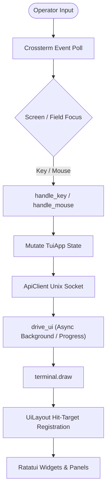

# TUI Module (`src/tui`)

> **Developer & AI Agent Reference Manual**  
> This document details the architecture, design principles, invariants, and best practices for developing and maintaining the Terminal User Interface (`traffic-masq`) module.

---

## 1. Overview & Architecture

The `src/tui` module implements the interactive terminal client binary (`traffic-masq`) built on top of [Ratatui](https://github.com/ratatui/ratatui) and [Crossterm](https://github.com/crossterm-rs/crossterm).

The TUI serves as the primary operational console for the `traffic-masq` networking suite, allowing network operators to configure network interfaces, uplink DHCP clients, DHCP servers, Wi-Fi access points, Wi-Fi client connections, WireGuard VPN tunnels, and router provisioning without losing access to remote machines.

### Key Operating Modes

1. **Daemon Mode (Default):**
   - Communicates with `traffic-masqd` over a local Unix domain socket (`/run/traffic-masq/traffic-masqd.sock`).
   - Fully interactive: supports all tabs (Interfaces, DHCP Server, DHCP Client (configurable in Settings), Router, VPN, Wi-Fi, Settings, Logs).
   - Authenticated via shared device password; supports secure session caching in `$XDG_STATE_HOME`.
   - All state modifications are transactional, subject to dry-run previews and automatic rollback timers.

2. **Direct / Recovery Mode (`--direct`):**
   - Directly binds to Linux Netlink via `RtnetlinkNetworkProvider`.
   - Read-only emergency inspection mode when `traffic-masqd` is down or unresponsive.
   - Restricts operations to the Dashboard and Interfaces tabs; daemon-dependent sections (DHCP, Wi-Fi, VPN, Router, Settings) are politely disabled with informational warnings.

---

## 2. Directory & Component Inventory

| File | Primary Responsibility | Key Types / Functions |
|---|---|---|
| [`mod.rs`](file:///home/user/Documents/programming/traffic_masq/traffic_masq/src/tui/mod.rs) | Application lifecycle, main event loop (`run_loop`), async UI driver (`drive_ui`), key/mouse dispatch, terminal initialization & RAII cleanup. | `TuiApp`, `Screen`, `Section`, `TerminalGuard`, `run_tui`, `drive_ui` |
| [`layout.rs`](file:///home/user/Documents/programming/traffic_masq/traffic_masq/src/tui/layout.rs) | Layout partitioning, panel wrappers, top header tab bar, bottom status & key hint footer, mouse hit testing primitives. | `UiLayout`, `panel`, `render_header`, `render_footer`, `point_in_rect`, `section_at` |
| [`input.rs`](file:///home/user/Documents/programming/traffic_masq/traffic_masq/src/tui/input.rs) | Unicode-safe interactive text editing, cursor navigation, blinking phase calculation, masked password span formatting. | `TextEditor`, `render_value_with_cursor`, `render_masked_with_cursor`, `is_cursor_blink_visible` |
| [`session.rs`](file:///home/user/Documents/programming/traffic_masq/traffic_masq/src/tui/session.rs) | Client-side persistent session caching, XDG state management, strict file permissions (`0700`/`0600`, `O_NOFOLLOW`), zeroization. | `SessionStore`, `SessionPreferences`, `remember`, `restore` |
| [`dashboard.rs`](file:///home/user/Documents/programming/traffic_masq/traffic_masq/src/tui/dashboard.rs) | System overview dashboard, interface summaries, live traffic sparklines (RX/TX rate histories with rate smoothing). | `DashboardData`, `DashboardFocus`, `TrafficHistory`, `TrafficSample` |
| [`interfaces.rs`](file:///home/user/Documents/programming/traffic_masq/traffic_masq/src/tui/interfaces.rs) | Network interface list and editor; address ownership tags (`[ext]`, `[?]`), default route risk warnings, dry-run change plan previews. | `InterfaceEditor`, `InterfaceEditorField`, `render_interface_list`, `render_preview` |
| [`dhcp.rs`](file:///home/user/Documents/programming/traffic_masq/traffic_masq/src/tui/dhcp.rs) | Downstream DHCP server configuration per interface, pool range validation, DNS settings, active lease viewer. | `DhcpEditor`, `DhcpField`, `DhcpLeasesView` |
| [`dhcp_client.rs`](file:///home/user/Documents/programming/traffic_masq/traffic_masq/src/tui/dhcp_client.rs) | Uplink DHCP client supervision view: operational states (`Running`, `Waiting`, `Degraded`), lease renewal, release, and defaults configuration. | `render`, `refresh`, `handle_dhcp_client_key` |
| [`router.rs`](file:///home/user/Documents/programming/traffic_masq/traffic_masq/src/tui/router.rs) | Router engine status, coordinator status, health checks, dataplane forwarding status, router plan inspection, rollback view. | `RouterData`, `RouterField`, `RouterPendingView`, `render_router` |
| [`provisioning.rs`](file:///home/user/Documents/programming/traffic_masq/traffic_masq/src/tui/provisioning.rs) | Multi-step interactive router provisioning wizard: uplink selection (Wi-Fi/Ethernet), output AP config, dry-run review, commit & rollback. | `ProvisioningWizard`, `NetworkChoice`, `PendingProvisioning` |
| [`wifi.rs`](file:///home/user/Documents/programming/traffic_masq/traffic_masq/src/tui/wifi.rs) | Wi-Fi subsystem management: AP configuration, Wi-Fi client scanning (`WifiScanPicker`), profile manager (`WifiProfilesView`), connect dialog. | `WifiData`, `WifiRole`, `WifiEditor`, `WifiScanPicker`, `WifiProfileEditor`, `WifiConnectPrompt` |
| [`vpn.rs`](file:///home/user/Documents/programming/traffic_masq/traffic_masq/src/tui/vpn.rs) | WireGuard VPN profile management, connection lifecycle, configuration import wizard, deletion confirmation. | `VpnData`, `VpnFocus`, `VpnImportEditor` |
| [`vpn_policy.rs`](file:///home/user/Documents/programming/traffic_masq/traffic_masq/src/tui/vpn_policy.rs) | Policy routing rules for WireGuard (routing marks, table IDs, client bypass policies). | `VpnPolicyData`, `VpnPolicyEditor` |
| [`settings.rs`](file:///home/user/Documents/programming/traffic_masq/traffic_masq/src/tui/settings.rs) | Daemon configuration, rollback timeout settings, session preferences, device password update wizard, configuration reload/reset. | `SecurityEditor`, `SettingsField`, `PasswordChangeEditor` |
| [`access.rs`](file:///home/user/Documents/programming/traffic_masq/traffic_masq/src/tui/access.rs) | Remote HTTPS access configuration (TLS listen socket, certificate and private key file paths). | `AccessEditor`, `AccessField` |
| [`logs.rs`](file:///home/user/Documents/programming/traffic_masq/traffic_masq/src/tui/logs.rs) | In-memory circular log buffer (`LOG_HISTORY_LEN = 500`), severity levels (`Info`, `Warn`, `Error`), F1 popup viewer, log export. | `LogEntry`, `LogLevel`, `LogFocus`, `render_log` |

---

## 3. Core Architectural Concepts & Invariants



### 3.1. The Async UI Driver (`drive_ui`)

In a terminal application, performing long-running network operations directly in the event loop causes the UI to freeze, drop keypresses, or fail to respond to window resizes. `traffic-masq` solves this with `drive_ui`:

1. **Non-blocking Polling Loop:** While awaiting a future (e.g. an API request or background status poll), `drive_ui` sleeps in 50ms intervals using `tokio::select!`.
2. **Snapshot-Based Progress Rendering:** On each 50ms tick, if an operation takes longer than 500ms, `render_operation_snapshot` draws a subtle progress banner:
   - Cancellable reads: `"Refreshing Xs. Displayed data may be stale; input interrupts refresh"`
   - Non-cancellable writes: `"Operation in progress Xs; rollback deadline in Ys. Q: exit after result; other actions disabled"`
3. **Cancellable vs. Non-Cancellable Operations:**
   - **Reads/Refreshes (`cancellable = true`):** If the user presses any key during a background refresh, the future is dropped immediately, returning the input event so the operator's action is processed without latency.
   - **Mutations/Applies (`cancellable = false`):** Network mutations are **never** cancelled or retried on timeout. A lost or delayed Unix socket response does not mean the daemon failed to apply the change. The UI permits pressing `q` to queue an exit after the response arrives, but blocks other inputs.
4. **Notification and Footer Integrity:** The progress banner renders on row `height - 3`. It explicitly preserves the key-hints row (`height - 2`), the error/status message row (`height - 1`), and the borders to eliminate visible screen flickering.

### 3.2. Two-Phase Commit & Rollback Protection

Because misconfiguring an IP address or firewall rule can sever SSH access, all destructive changes follow a strict rollback pattern:
1. **Dry-Run Preview:** Before modifying state, the daemon calculates a diff (`InterfaceChangePlan`, `RouterPlan`, `RouterProvisioningPreviewView`). The TUI presents this plan on a dedicated preview screen (`Screen::Preview`, `Screen::RouterPlan`).
2. **Pending State (`Screen::PendingChange`, `Screen::RouterPending`):**
   - When the user confirms the plan, the change is applied with a hardware rollback timer (e.g. 60 seconds).
   - The TUI transitions to a Pending screen displaying a live countdown timer:
     $$\text{Remaining} = \text{expires\_at\_unix} - \text{current\_unix\_time}()$$
   - Pressing **Enter** sends a commit request, making the change permanent.
   - Pressing **Esc** immediately triggers a rollback.
   - If the connection drops or the operator does not respond, the daemon automatically rolls back to the previous state when the timer expires.
3. **Disconnect Handling:** If the daemon becomes unreachable while on a pending screen, the TUI retains the pending change state and warns the operator that the outcome is unverified rather than falsely claiming success.

### 3.3. Screen and Section State Machine

Navigation is structured around 9 top-level **Sections** represented by the top tab bar:
`Dashboard` $\to$ `Interfaces` $\to$ `Dhcp` $\to$ `DhcpClient` $\to$ `Router` $\to$ `Vpn` $\to$ `Wifi` $\to$ `Settings` $\to$ `Log`.

- Every fine-grained `Screen` maps to its parent `Section` via `section_of(Screen)`.
- Left/Right arrows cycle through sections **only** when not currently editing an input field or trapped in a modal sub-flow.
- **Modal Isolation:** If an operator is inside an active editor (e.g. `InterfaceEditor`, `WifiEditor`, `ProvisioningWizard`), tab switching is prohibited until the user exits with `Esc` or completes the action with `Enter`.

### 3.4. Hit-Testing & Mouse Coordinates (`UiLayout`)

Mouse support is dynamically synchronized during the rendering pass:
- During each frame render, widgets register their active hit targets into `app.ui`:
  - `app.ui.tabs`: Array of `Rect`s for each section tab in the header.
  - `app.ui.buttons`: Vector of `(Rect, slot)` tuples for clickable action buttons.
  - `app.ui.list_area`: The bounding `Rect` of the current scrollable list.
  - `app.ui.list_row_height`: Height in terminal lines per row (e.g. 1 for simple items, 3 for DHCP clients).
  - `app.ui.list_scroll_offset`: Current viewport top index.
- When `handle_mouse` receives a click:
  - If inside `tabs`, it calls `navigate_to_section`.
  - If inside a button rect in `buttons`, it activates the corresponding slot.
  - If inside `list_area`, it translates the terminal row to the model index:
    $$\text{index} = \text{list\_scroll\_offset} + \frac{\text{mouse.row} - \text{list\_area.y}}{\text{list\_row\_height}}$$
- When terminal dimensions fall below the minimum threshold ($60 \times 15$), `app.ui.input_enabled` is set to `false`, and all hit regions are wiped clean to avoid ghost clicks.

### 3.5. Text Input & Cursor Safety

Never manipulate UTF-8 strings by raw byte indexing. The helper `input::TextEditor` wraps `(&mut String, &mut usize)`:
- Uses `chars().count()` for visual cursor position and `char_indices()` for byte slicing.
- Automatically clamps cursor boundaries on insertion, deletion, backspace, home, and end.
- Provides `is_cursor_blink_visible()` based on 500ms intervals since Unix epoch.
- Password fields use `render_masked_with_cursor` to obscure secrets while maintaining full cursor positioning fidelity.

### 3.6. Security, Zeroization & Session Storage

1. **Zeroization:** Structs storing sensitive passphrases (e.g. `ProvisioningWizard`, `PasswordChangeEditor`, authentication buffers) implement `Drop` to call `.zeroize()` on underlying strings.
2. **Session Persistence (`session.rs`):**
   - Stored under `$XDG_STATE_HOME/traffic-masq/client/<sha256-of-socket-path>.session.json`.
   - File and directory permissions must be strictly verified: owner UID match, directory mode `0700`, file mode `0600`.
   - Must reject symlinks and open files with `O_NOFOLLOW`.
   - Writes are performed atomically using temporary files and directory fsyncs.
   - Changing the device password immediately invalidates all stored sessions across all clients.

---

## 4. Best Practices for Modifying the TUI

When adding features, screens, or fixing bugs in `src/tui`, adhere to the following rules:

### Rule 1: Use Typed Enums, Never Magic Numbers
Do not use raw integers for button slots, action indices, or menu choices.
```rust
// BAD:
if slot == 2 {
    delete_profile(app).await;
}

// GOOD:
#[derive(Debug, Clone, Copy, PartialEq, Eq)]
pub(crate) enum WifiProfileAction {
    Activate,
    Edit,
    Delete,
}

impl WifiProfileAction {
    pub const ALL: [Self; 3] = [Self::Activate, Self::Edit, Self::Delete];
    pub fn from_index(index: usize) -> Option<Self> {
        Self::ALL.get(index).copied()
    }
}
```

### Rule 2: Isolate Left / Right Arrow Navigation While Editing
When an input field is being edited, `KeyCode::Left` and `KeyCode::Right` must move the text cursor within the field and **must not** switch top-level tabs.
- Always check `is_editing()` or whether a text field is active before dispatching section changes.

### Rule 3: Never Discard Operator Drafts on Background Refresh
The periodic background refresh in `run_loop` polls daemon data.
- If the operator is currently on an editor screen (`Screen::InterfaceEditor`, `Screen::WifiEditor`, etc.), **do not** overwrite form fields with remote status.
- Keep the draft intact until the operator explicitly cancels or submits.

### Rule 4: Always Check `direct` Mode Flags
If a feature relies on `traffic-masqd`:
- Verify `direct` mode in navigation and action handlers.
- If in direct mode, reject the operation gracefully with:
  ```rust
  app.push_message(
      LogLevel::Warn,
      "This operation requires the daemon API; unavailable in direct/offline mode",
  );
  ```

### Rule 5: Keep Hit Targets Synchronized with Rendering
If you render a button or clickable row:
- Register its bounding `Rect` and index into `app.ui.buttons` or `app.ui.list_area` in the **same** render function.
- If the widget is conditionally hidden, do not register the hit rect.

### Rule 6: Implement RAII Drop Cleanups for Sensitive Data
If a struct holds Wi-Fi passphrases, private keys, or passwords:
```rust
impl Drop for MySecretEditor {
    fn drop(&mut self) {
        self.passphrase.zeroize();
    }
}
```

### Rule 7: Update All Routing Matrices When Adding a Screen
When adding a new `Screen` variant:
1. Add to `enum Screen` in `mod.rs`.
2. Map it to the appropriate section in `section_of(Screen)`.
3. Provide keyboard shortcuts in `layout::screen_help_pairs(Screen)`.
4. Handle rendering in `render(...)` in `mod.rs`.
5. Route key events in `handle_key(...)` in `mod.rs`.
6. Route mouse events in `handle_mouse(...)` in `mod.rs` if interactive.

---

## 5. Testing Patterns

The TUI module utilizes `ratatui::backend::TestBackend` extensively for deterministic, offline testing without needing an active terminal or root privileges.

### Pattern 1: Testing Layouts and Text Output
Verify that rendered widgets contain expected text, correct styling, and accurate row placements:
```rust
#[test]
fn test_screen_rendering() {
    let mut terminal = Terminal::new(TestBackend::new(80, 24)).unwrap();
    let mut app = TuiApp::default();
    
    terminal.draw(|frame| render(frame, &mut app, false)).unwrap();
    
    let buffer = terminal.backend().buffer();
    let row_text: String = (0..80).map(|x| buffer[(x, 2)].symbol()).collect();
    assert!(row_text.contains("Interfaces"));
}
```

### Pattern 2: Testing Hit Regions & Button Rects
Ensure clickable elements have valid coordinates that stay within viewport boundaries:
```rust
#[test]
fn test_preview_cancel_button_click_target() {
    let mut app = TuiApp::default();
    // Configure app state...
    let mut terminal = Terminal::new(TestBackend::new(80, 24)).unwrap();
    terminal.draw(|frame| render_preview(frame, frame.area(), &mut app)).unwrap();

    let (rect, slot) = app.ui.buttons.iter()
        .find(|(_, slot)| *slot == 1)
        .expect("Cancel button must have a hit target");
    assert!(rect.y < 24);
}
```

### Pattern 3: Testing Keyboard State Machines Offline
Pass a dummy socket client (`ApiClient::new("/nonexistent.sock")`) to test state transitions without network calls:
```rust
#[tokio::test]
async fn test_editor_navigation() {
    let mut app = TuiApp::default();
    let client = ApiClient::new("/nonexistent.sock");

    handle_editor_key(&mut app, KeyCode::Char('a'), &client).await;
    assert_eq!(app.editor.as_ref().unwrap().cursor, 1);
}
```

### Pattern 4: Terminal Resize & Clipping Verification
Verify that reducing terminal dimensions below $60 \times 15$ properly degrades into a warning banner and wipes hit targets:
```rust
#[tokio::test]
async fn resize_clears_hit_regions() {
    let mut terminal = Terminal::new(TestBackend::new(40, 10)).unwrap();
    let mut app = TuiApp::default();

    terminal.draw(|frame| render(frame, &mut app, false)).unwrap();

    assert!(app.ui.buttons.is_empty());
    assert!(app.ui.list_area.is_none());
    assert!(!app.ui.input_enabled);
}
```

---

## 6. Common Pitfalls & Troubleshooting

- **Terminal Left in Raw Mode on Crash:** If developing outside the standard harness, ensure `TerminalGuard` dropped cleanly. If a test or development binary panics before teardown, run `reset` in your shell.
- **Lost Rollback Context:** If the daemon restarts while a rollback timer is running, the TUI detects the token invalidation and resets the pending screen with an explicit warning. Never assume an expired transaction succeeded.
- **Double-Draw Artifacts:** Do not invoke `terminal.draw` inside sub-functions. All rendering must originate from the top-level `run_loop` or the snapshot callback in `drive_ui`.
- **UTF-8 Panic on Slicing:** Avoid `&str[..cursor]`. Always use `input::TextEditor` or `text.chars().take(cursor).collect::<String>()`.
